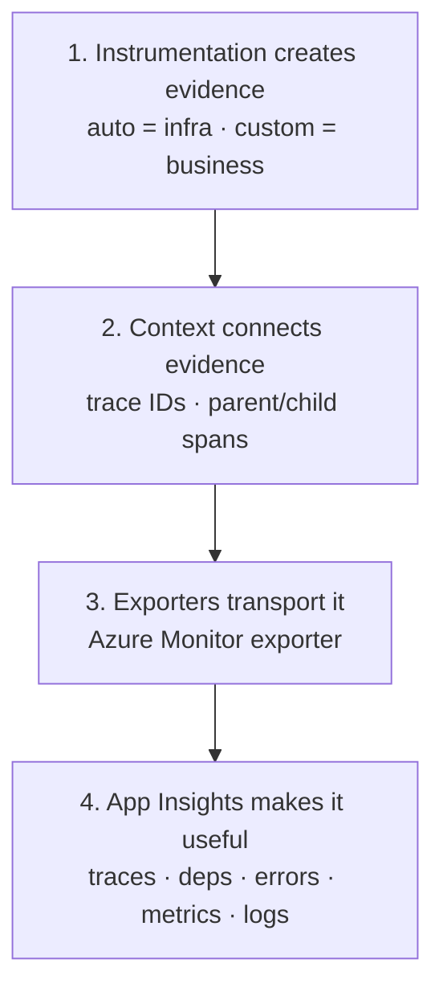

- OpenTelemetry (OTel) is the **standard way to generate, collect, and export telemetry** from your application
  1. **Generate** — create the telemetry data inside your app (spans, metrics, logs)
  2. **Collect** — gather that data in-process (and optionally via a Collector): batch, sample, filter, enrich
  3. **Export** — send the collected telemetry to a backend over a protocol (e.g. OTLP)
- Helps you understand what happened during a request, how long it took, and where it failed
- Instrument once, then choose where to send telemetry (Azure App Insights, Collector, etc.)

## Mental model — three signals

- Think of a production app as a black box. OTel gives you three kinds of evidence:

| Signal      | Answers                                        | Example                                            |
| ----------- | ---------------------------------------------- | -------------------------------------------------- |
| **Traces**  | Where did the request spend its time?          | HTTP → PostgreSQL → LLM call                       |
| **Metrics** | Is the system getting slower or less reliable? | request rate, error rate, p95 latency, queue depth |
| **Logs**    | What happened, and what details explain it?    | validation failed, payment provider timed out      |

## Core terminology

| Term                   | Mental model                          | Example                                  |
| ---------------------- | ------------------------------------- | ---------------------------------------- |
| **Span**               | One timed operation                   | `orders.create`                          |
| **Trace**              | Complete journey of a request         | create → charge → save                   |
| **Span context**       | Identity / correlation                | Trace ID + Span ID                       |
| **Parent/child spans** | Call hierarchy                        | HTTP request contains DB query span      |
| **Propagation**        | Carry trace identity across services  | `traceparent` HTTP header                |
| **Attributes**         | Searchable metadata on a span         | `order.type = "subscription"`            |
| **Events**             | Timestamped occurrences inside a span | `retry.started`                          |
| **Resource**           | Identity of the emitting service      | `service.name = "orders-api"`            |
| **Instrumentation**    | Code that produces telemetry          | HTTP auto-instrumentation / custom spans |
| **Exporter**           | Sends telemetry to a destination      | Azure Monitor exporter                   |
| **Sampling**           | Decide which traces to retain         | Sample a % of requests                   |

- A **span** is the fundamental unit of tracing: start/end time, status, attributes, events, child spans

## Collector (optional)

- Direct export to Azure is simpler; a Collector adds centralized processing and multi-destination routing
- Separate telemetry pipeline. Used to filter and route telemetry data
- Collector is a vendor-agnostic proxy that receives, processes, and exports telemetry data
- Instead of your app sending metrics, traces, and logs directly to a backend (Azure App Insight), it sends them to the Collector first

## TypeScript project structure

```text title='project layout'
src/
├── telemetry/
│   ├── instrumentation.ts   # Initialize OTel / Azure exporter
│   ├── tracing.ts           # Custom span helpers
│   └── metrics.ts           # Custom business metrics
├── ...
```

- Bootstrap rule: initialize instrumentation **before** importing libraries you want to instrument
- Built-in & custom instrumentation rule:
  1. first, use auto-instrument (broad coverage)
  2. second, use custom (business context)

## Azure Application Insights setup

1. Create an **Application Insights** resource in Azure portal
2. Copy the **connection string** from Overview
3. Set env var `APPLICATIONINSIGHTS_CONNECTION_STRING` (Key Vault / deployment config in prod — never hardcode)
4. Once data start flowing in Azure, use Azure Query language (similar to DB query)

## Retain this loop



**Fastest path:** Azure bootstrap → verify HTTP + dependencies in App Insights → add custom spans around highest-value business operations.

## Custom spans

```js title='src/telemetry/tracing.js'
const { trace, SpanStatusCode } = require("@opentelemetry/api");

const tracer = trace.getTracer("tracer-name");

// Reusable wrapper function to trace operations. e.g. instrumentedOperation -> createOrder
async function instrumentedOperation(operation) {
  return tracer.startActiveSpan("span.name", async (span) => {
    span.setAttribute("key", "value");
    try {
      return await operation();
    } catch (error) {
      span.recordException(
        error instanceof Error ? error : new Error(String(error)),
      );
      span.setStatus({ code: SpanStatusCode.ERROR });
      throw error;
    } finally {
      span.end();
    }
  });
}
```

```ts title='Usage in service'
import { createOrder } from "../telemetry/tracing";

export async function handleCreateOrder() {
  return createOrder("order-123", async () => {
    await saveOrderToDatabase();
    await chargePaymentProvider();
    return { success: true };
  });
}
```

- Always **end** spans, **record** errors, and **rethrow** unless business logic handles them
- Auto-instrumented DB/HTTP calls appear as child spans when context propagation is correct

## Custom metrics

- Use **metrics** for counts/rates/aggregates; use **spans** to investigate individual operations
- To track business events like the number of orders placed, you want to use a Counter instrument
- You can also pass dimensional attributes along with the metric value

```ts title='order metrics'
// When orderCounter.add(1) executes, OpenTelemetry updates a localized running total in your application memory.
// OTel SDK periodically flushes these aggregated totals out of memory to the backend store

const { metrics } = require("@opentelemetry/api");

// 1. Initialize your meter
const meter = metrics.getMeter("orders-service", "1.0.0");

// 2. Create the Counter instrument
const orderCounter = meter.createCounter("orders_placed_total", {
  description: "Tracks the total number of orders successfully placed",
  unit: "{order}",
});

/**
 * Decorator-style wrapper that increments a counter when an order completes
 */
function withOrderMetric(paymentMethod, operation) {
  return async (...args) => {
    try {
      const result = await operation(...args);

      // Increment by 1 on success, adding dimensions for calculation slicing
      orderCounter.add(1, {
        "payment.method": paymentMethod,
        "order.status": "success",
      });

      return result;
    } catch (error) {
      // Still track the event, but categorise it as a failure
      orderCounter.add(1, {
        "payment.method": paymentMethod,
        "order.status": "failed",
      });
      throw error;
    }
  };
}

// 3. Application Usage Example
async function processCheckout() {
  const checkoutOperation = withOrderMetric("credit_card", async () => {
    // Your actual checkout logic goes here
    await saveOrderToDatabase();
    return { success: true };
  });

  return await checkoutOperation();
}
```

## Trace Architecture

- Every action shares a single **Trace ID**. Each individual step generates a **Span ID** that references its parent step.

```text title='trace & Span Id'
[Trace ID: 00000abc]
└── Place Order (Root Span ID: 1111)
     ├── Payment Process (Child Span ID: 2222, Parent ID: 1111)
     └── Confirm Order   (Child Span ID: 3322, Parent ID: 1111)
```

```ts title='Example
// place order -> payment process -> confirm order
import { tracer } from "opentelemetry";

// STEP 1: Place Order (The entry point / Root Span)
function placeOrder() {
  // Start the parent span
  const orderSpan = tracer.startSpan("Place Order");

  try {
    // 1. Save order to database
    const orderId = "order_999";
    orderSpan.setAttribute("order.id", orderId);

    // 2. Trigger payment, passing the current trace context down
    const currentContext = tracer.getCurrentContext();
    const paymentSuccess = processPayment(currentContext, orderId);

    // 3. If successful, trigger confirmation
    if (paymentSuccess) {
      confirmOrder(currentContext, orderId);
    }

    orderSpan.setStatus("SUCCESS");
  } catch (error) {
    orderSpan.setStatus("ERROR");
    orderSpan.recordError(error);
  } finally {
    // End the span to send data to the collector
    orderSpan.end();
  }
}

// STEP 2: Process Payment (Child Span)
function processPayment(parentContext, orderId) {
  // Link this new span directly to the parent context
  const paymentSpan = tracer.startSpan("Payment Process", {
    parent: parentContext,
  });

  try {
    // Execute payment gateway logic
    paymentSpan.setAttribute("payment.amount", 150.0);

    paymentSpan.setStatus("SUCCESS");
    return true;
  } catch (error) {
    paymentSpan.setStatus("ERROR");
    return false;
  } finally {
    paymentSpan.end();
  }
}

// STEP 3: Confirm Order (Child Span)
function confirmOrder(parentContext, orderId) {
  // Link this new span to the same parent context
  const confirmSpan = tracer.startSpan("Confirm Order", {
    parent: parentContext,
  });

  try {
    // Deduct inventory and send email notification
    confirmSpan.setAttribute("notification.type", "email");

    confirmSpan.setStatus("SUCCESS");
  } catch (error) {
    confirmSpan.setStatus("ERROR");
  } finally {
    confirmSpan.end();
  }
}
```

## Hide sensitive data

- scrub it either at the application level (SDK) before it leaves your app, or at the infrastructure level (Collector) before it reaches your storage backend
- Disabling Automatic Instrumentation Captures:
  - Many automatic OTel libraries (like HTTP, Express, or gRPC plugins) capture headers and query parameters by default
  - You can explicitly turn these off or restrict them when registering plugins

```ts title='Custom Span Processor'
export class DataMaskingProcessor implements SpanProcessor {
  onEnd(span: ReadableSpan): void {
    const attributes = span.attributes;
    // Inspect and scrub forbidden keys
    if (attributes["user.email"]) {
      // Modify mutable properties inside your SDK configuration context safely
      span.attributes["user.email"] = "REDACTED";
    }

    if (attributes["db.statement"]) {
      // Apply pattern matching logic on raw string attributes
      const rawQuery = attributes["db.statement"] as string;
      (span.attributes as any)["db.statement"] = rawQuery.replace(
        /password=\w+/g,
        "password=***",
      );
    }
  }
}
```

## Production rules

| Decision            | Guidance                                                           |
| ------------------- | ------------------------------------------------------------------ |
| Auto vs custom      | Auto first; custom spans around business ops                       |
| Sampling            | Start with defaults; tune for traffic, diagnostics, ingestion cost |
| Direct vs Collector | Direct = simple; Collector = central processing / multi-route      |
| Sensitive data      | Never attach passwords, tokens, payment details                    |
| Propagation         | Preserve context across HTTP and message queues                    |
| Performance         | Batch telemetry; monitor cost; load-test                           |
| Shutdown            | Flush telemetry on graceful shutdown when SDK supports it          |

## P95 latency

- 95th percentile latency
- E.x, if an API has a P95 latency of 200 ms, it means 95 out of every 100 requests finish in 200 milliseconds or less, while the remaining 5 requests take longer.
- Why P95 Latency Matters More Than Averages: Averages hide slow experiences & Finds system bottlenecks
