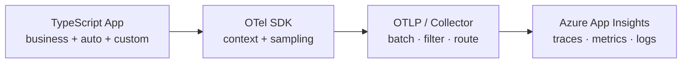
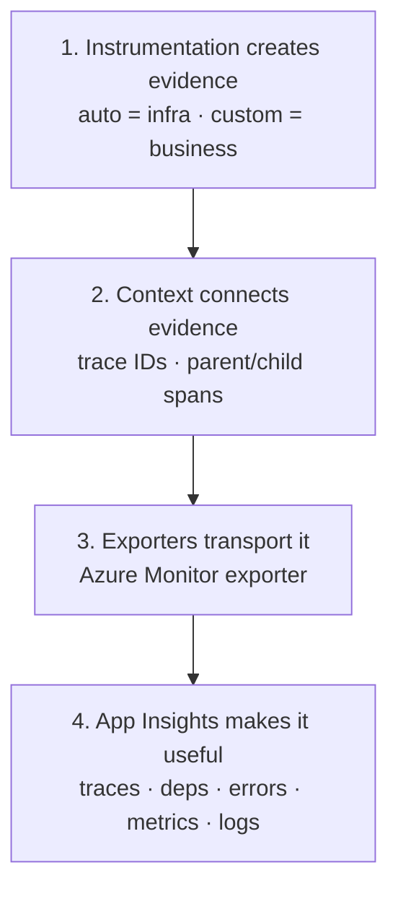

- OpenTelemetry (OTel) is the **standard way to generate, collect, and export telemetry** from your application
  1. **Generate** — create the telemetry data inside your app (spans, metrics, logs)
  2. **Collect** — gather that data in-process (and optionally via a Collector): batch, sample, filter, enrich
  3. **Export** — send the collected telemetry to a backend over a protocol (e.g. OTLP)
- Helps you understand what happened during a request, how long it took, and where it failed
- Instrument once, then choose where to send telemetry (Azure App Insights, Collector, etc.)

## Mental model — three signals

- Think of a production app as a black box. OTel gives you three kinds of evidence:

| Signal      | Answers                                        | Example                                            |
| ----------- | ---------------------------------------------- | -------------------------------------------------- |
| **Traces**  | Where did the request spend its time?          | HTTP → PostgreSQL → LLM call                       |
| **Metrics** | Is the system getting slower or less reliable? | request rate, error rate, p95 latency, queue depth |
| **Logs**    | What happened, and what details explain it?    | validation failed, payment provider timed out      |



- Direct export to Azure is simpler; a Collector adds centralized processing and multi-destination routing

## Core terminology

| Term                   | Mental model                          | Example                                  |
| ---------------------- | ------------------------------------- | ---------------------------------------- |
| **Span**               | One timed operation                   | `orders.create`                          |
| **Trace**              | Complete journey of a request         | create → charge → save                   |
| **Span context**       | Identity / correlation                | Trace ID + Span ID                       |
| **Parent/child spans** | Call hierarchy                        | HTTP request contains DB query span      |
| **Propagation**        | Carry trace identity across services  | `traceparent` HTTP header                |
| **Attributes**         | Searchable metadata on a span         | `order.type = "subscription"`            |
| **Events**             | Timestamped occurrences inside a span | `retry.started`                          |
| **Resource**           | Identity of the emitting service      | `service.name = "orders-api"`            |
| **Instrumentation**    | Code that produces telemetry          | HTTP auto-instrumentation / custom spans |
| **Exporter**           | Sends telemetry to a destination      | Azure Monitor exporter                   |
| **Collector**          | Separate telemetry pipeline           | Batch, filter, route                     |
| **Sampling**           | Decide which traces to retain         | Sample a % of requests                   |

- A **span** is the fundamental unit of tracing: start/end time, status, attributes, events, child spans

```
POST /orders                          [root · 320 ms]
├── Validate order                    [12 ms]
├── PostgreSQL INSERT                 [28 ms]
└── Payment provider                  [250 ms · slow]
```

> Span durations can overlap — they do not always sum to the root duration.

## Built-in vs custom instrumentation

```
Strategy: auto-instrument first → custom second
          (broad coverage)         (business context)
```

| Approach      | How                                                  | Best for                                                      |
| ------------- | ---------------------------------------------------- | ------------------------------------------------------------- |
| **Automatic** | Install library instrumentations (HTTP, Express, DB) | Incoming requests, outgoing HTTP, baseline latency/errors     |
| **Custom**    | Manual spans, attributes, events, metrics            | Checkout, RAG, model inference, queue work, business outcomes |

## TypeScript project structure

```
src/
├── telemetry/
│   ├── instrumentation.ts   # Initialize OTel / Azure exporter
│   ├── tracing.ts           # Custom span helpers
│   └── metrics.ts           # Custom business metrics
├── routes/
│   └── orders.ts
├── services/
│   └── order-service.ts
├── app.ts
└── server.ts
```

- **Bootstrap rule:** initialize instrumentation **before** importing libraries you want to instrument (critical for ESM)

## Azure Application Insights setup

### 1. Create resource

1. Create an **Application Insights** resource in Azure portal
2. Copy the **connection string** from Overview
3. Set env var `APPLICATIONINSIGHTS_CONNECTION_STRING` (Key Vault / deployment config in prod — never hardcode)

### 2. Install

```bash
npm install @microsoft/opentelemetry @opentelemetry/api
```

- Prefer Microsoft's **OpenTelemetry Distro** (`@microsoft/opentelemetry`) for new Node apps
- Existing apps on `@azure/monitor-opentelemetry` do not need to migrate solely because of the package rename

### 3. Bootstrap (ESM)

```js title='src/telemetry/instrumentation.mjs'
import "@microsoft/opentelemetry/loader";
import { useMicrosoftOpenTelemetry } from "@microsoft/opentelemetry";

useMicrosoftOpenTelemetry({
  azureMonitor: {
    azureMonitorExporterOptions: {
      connectionString: process.env.APPLICATIONINSIGHTS_CONNECTION_STRING,
    },
  },
});
```

```bash
# Preload bootstrap before app modules
node --import ./dist/telemetry/instrumentation.mjs ./dist/server.js
```

## Custom spans

```ts title='src/telemetry/tracing.ts'
import { trace, SpanStatusCode } from "@opentelemetry/api";

const tracer = trace.getTracer("orders-api");

export async function createOrder<T>(
  orderId: string,
  operation: () => Promise<T>,
): Promise<T> {
  return tracer.startActiveSpan("orders.create", async (span) => {
    span.setAttribute("order.id", orderId);
    span.setAttribute("order.operation", "create");
    try {
      return await operation();
    } catch (error) {
      span.recordException(
        error instanceof Error ? error : new Error(String(error)),
      );
      span.setStatus({ code: SpanStatusCode.ERROR });
      throw error;
    } finally {
      span.end();
    }
  });
}
```

```ts title='Usage in service'
import { createOrder } from "../telemetry/tracing";

export async function handleCreateOrder() {
  return createOrder("order-123", async () => {
    await saveOrderToDatabase();
    await chargePaymentProvider();
    return { success: true };
  });
}
```

- Always **end** spans, **record** errors, and **rethrow** unless business logic handles them
- Auto-instrumented DB/HTTP calls appear as child spans when context propagation is correct

## Custom metrics

```ts title='src/telemetry/metrics.ts'
import { metrics } from "@opentelemetry/api";

const meter = metrics.getMeter("orders-api");

export const ordersCreated = meter.createCounter("orders.created", {
  description: "Number of orders created",
});

export function recordOrderCreated(): void {
  ordersCreated.add(1, { result: "success" });
}
```

- Call after successful business outcomes
- Use **metrics** for counts/rates/aggregates; use **spans** to investigate individual operations

## Verify in Azure

- Inspect **Application Map**, **Live Metrics**, and **Logs**
- `OperationId` correlates requests, dependencies, and logs

```kusto title='Recent requests'
AppRequests
| where TimeGenerated > ago(1h)
| project TimeGenerated, Name, DurationMs, Success, ResultCode, OperationId
| order by TimeGenerated desc
| take 50
```

```kusto title='Slow dependencies'
AppDependencies
| where TimeGenerated > ago(1h)
| project TimeGenerated, Name, Target, DurationMs, Success, OperationId
| order by DurationMs desc
| take 50
```

```kusto title='Traces / log messages'
AppTraces
| where TimeGenerated > ago(1h)
| project TimeGenerated, Message, SeverityLevel, OperationId
| order by TimeGenerated desc
| take 100
```

## Production rules

| Decision               | Guidance                                                           |
| ---------------------- | ------------------------------------------------------------------ |
| Auto vs custom         | Auto first; custom spans around business ops                       |
| Sampling               | Start with defaults; tune for traffic, diagnostics, ingestion cost |
| Direct vs Collector    | Direct = simple; Collector = central processing / multi-route      |
| High-cardinality attrs | Avoid unique IDs as **metric** dimensions (explodes time series)   |
| Sensitive data         | Never attach passwords, tokens, payment details, raw PII           |
| Propagation            | Preserve context across HTTP and message queues                    |
| Performance            | Batch telemetry; monitor cost; load-test                           |
| Shutdown               | Flush telemetry on graceful shutdown when SDK supports it          |

- **Sampling** controls trace volume; **metric cardinality** controls distinct time series — different problems

## Retain this loop



**Fastest path:** Azure bootstrap → verify HTTP + dependencies in App Insights → add custom spans around highest-value business operations.

## P95 latency

- 95th percentile latency
- E.x, if an API has a P95 latency of 200 ms, it means 95 out of every 100 requests finish in 200 milliseconds or less, while the remaining 5 requests take longer.
- Why P95 Latency Matters More Than Averages: Averages hide slow experiences & Finds system bottlenecks
