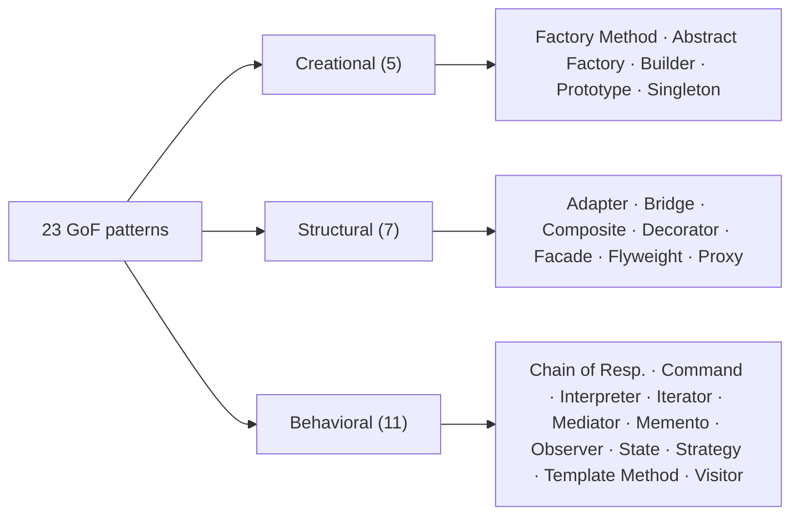
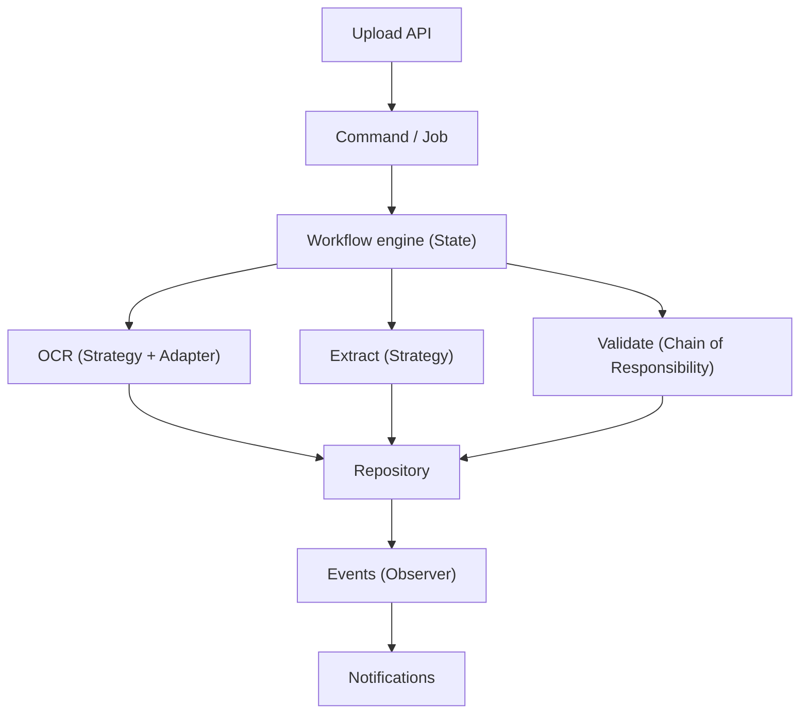

- **Design pattern**: a proven, named structure for a recurring design problem. It is a shape, not a library
- **SOLID**: five principles for managing change, dependencies, and complexity. Patterns are often how you implement them
- Core idea: **separate what changes independently** (providers, algorithms, formats, rules, workflows)
- The skill is not memorising all 23 patterns. It is telling look-alike patterns apart and choosing the **simplest design** that isolates the real variation
- In TypeScript, functions, interfaces, modules, and composition often replace class-heavy GoF structures

## Mental model

```text title='before: one service owns every variation'
OrderService
    +-- if Stripe -> Stripe API
    +-- if PayPal -> PayPal API
    +-- if premium customer -> discount A
    +-- if coupon -> discount B
    +-- send email / SMS / push
```

```text title='after: each variation sits behind a contract'
                    OrderService
                         |
              +----------+----------+
              |          |          |
          Payment     Discount   Notifier
          Strategy     Policy     Interface
              |          |          |
          Providers    Rules     Email/SMS/Push
```

| Category | Question it answers | Count |
| -------- | ------------------- | ----- |
| **Creational** | How do we create objects without spreading construction details everywhere? | 5 |
| **Structural** | How do we combine objects into larger systems without tight coupling? | 7 |
| **Behavioral** | How do objects collaborate, share responsibilities, and change behaviour? | 11 |



## Core terminology

| Term | Mental model | Example |
| ---- | ------------ | ------- |
| **Coupling** | How much one module knows about another | Checkout imports `StripeSdk` directly |
| **Cohesion** | How related the things inside one module are | Pricing class only does pricing |
| **Abstraction / contract** | Stable interface that callers depend on | `PaymentGateway.charge()` |
| **Composition** | Build behaviour by wiring objects together | `new Cache(new Logging(db))` |
| **Inheritance** | Reuse by subclassing | `CsvImporter extends DataImporter` |
| **Dependency injection** | Pass dependencies in instead of creating them inside | `new CheckoutService(gateway)` |
| **Idempotency** | Repeating an operation has the same effect as doing it once | Retry with `idempotencyKey: orderId` |

## SOLID

| Principle | Mental model | Question to ask | Trade-off |
| --------- | ------------ | --------------- | --------- |
| **SRP**: Single Responsibility | One coherent reason to change, driven by a stakeholder | Does this module have unrelated reasons to change? | Too many tiny classes add navigation overhead |
| **OCP**: Open/Closed | Add new behaviour without repeatedly editing stable code | Can I add a variant without editing the core logic? | Don't abstract for hypothetical futures |
| **LSP**: Liskov Substitution | Every implementation honours the contract callers expect | Can this implementation safely replace another? | Broad interfaces force misleading implementations |
| **ISP**: Interface Segregation | Clients don't depend on methods they don't use | Is a client forced to depend on methods it doesn't use? | Over-fragmented interfaces are hard to follow |
| **DIP**: Dependency Inversion | Business logic depends on abstractions, not SDKs | Does business logic depend on implementation details? | Only abstract real boundaries and volatile parts |

```text title='SRP: split by reason to change'
OrderService                         OrderService
  +-- calculate total                /     |      \
  +-- save to DB          →     Pricing  Repository  Invoice
  +-- generate invoice PDF                              |
  +-- send email                                     Notifier
```

```ts title='OCP: new discount = new class, not a new if-branch'
interface DiscountPolicy { calculate(total: number): number }

class VipDiscount implements DiscountPolicy { calculate(t) { return t * 0.2 } }
class SeasonalDiscount implements DiscountPolicy { calculate(t) { return t * 0.1 } }

finalPrice(total, policy) = total - policy.calculate(total)
```

```ts title='LSP + ISP: small capability interfaces'
// Bad: class Penguin extends Bird { fly() { throw "can't fly" } }
interface Bird { eat(): void }
interface Flyable { fly(): void }

class Eagle implements Bird, Flyable { ... }
class Penguin implements Bird { ... }          // never promises fly()

// Bad: interface Machine { print(); scan(); fax() }
class BasicPrinter implements Printable { ... }
class OfficeMachine implements Printable, Scannable { ... }
```

```text title='DIP: invert the arrow'
Bad:    CheckoutService ---> StripeSdk

Better: CheckoutService ---> PaymentGateway   (abstraction owned by business logic)
                                  ^
                                  |
                             StripeAdapter    (detail depends on abstraction)
```

- DIP in practice:
  1. **Swap providers**: replace Stripe with PayPal without touching checkout
  2. **Test with fakes**: in unit tests, inject `FakeRepository` instead of a real database
  3. **Switch vendors**: change the LLM vendor while orchestration stays the same

## Creational patterns

| Pattern | Problem | Real-world use | Trade-off |
| ------- | ------- | -------------- | --------- |
| **Factory Method** | Caller shouldn't know which concrete class to create | Parser per upload format; email provider per tenant | Extra indirection; use only when selection really varies |
| **Abstract Factory** | Create **families** of related objects that must match | Light/dark theme components; per-cloud storage + queue clients | Cumbersome if products are unrelated or variants explode |
| **Builder** | Build a complex object step by step, no huge constructor | HTTP request, LLM request, report with optional sections | Overkill for 2–3 required fields |
| **Prototype** | Create new objects by copying a configured instance | Clone workflow template per customer; duplicate a document | Deep vs shallow copy; never clone sockets or DB handles |
| **Singleton** | One shared instance within a runtime scope | Config registry, metrics collector, process-local cache | Hidden global state, hard to test; **one per process**, not per cluster |

```ts title='Factory Method'
function createParser(format: "pdf" | "csv"): Parser {
  switch (format) {
    case "pdf": return new PdfParser()
    case "csv": return new CsvParser()
  }
}
createParser("pdf").parse(content)
// Strict GoF form: an overridable creator method in a creator class hierarchy
```

```ts title='Abstract Factory'
interface UIThemeFactory { createButton(): Button; createInput(): Input }
class LightTheme implements UIThemeFactory { createButton() { return new LightButton() } ... }

renderForm(factory) = [factory.createButton().render(), factory.createInput().render()]
```

```ts title='Builder'
const request = new LlmRequestBuilder()
  .setModel("reasoning-model")
  .addMessage("Summarize this document")
  .setTemperature(0.1)
  .build()                       // validate here: throw if no messages
```

```ts title='Prototype'
const customerWorkflow = structuredClone(template)   // deep copy
customerWorkflow.name = "Customer A invoice workflow"
```

```ts title='Singleton'
class AppConfig {
  private static instance?: AppConfig
  private constructor() {}
  static getInstance() { return (this.instance ??= new AppConfig()) }
}
// Server apps: prefer a DI container that provides one shared instance per app
```

## Structural patterns

| Pattern | Think of it as | Real-world use | Trade-off |
| ------- | -------------- | -------------- | --------- |
| **Adapter** | Translate an incompatible interface | Wrap payment SDK as `PaymentGateway`; normalise LLM vendors | Extra layer, but isolates vendor changes |
| **Bridge** | Separate two independent dimensions | Notification type × delivery channel; report format × data source | Pointless with a single fixed implementation |
| **Composite** | Treat a tree uniformly | Files/folders, UI trees, product bundles | Leaf-only operations fit awkwardly |
| **Decorator** | Wrap to add behaviour, same interface | Logging, metrics, retries, caching around a client | **Order matters** |
| **Facade** | Simple entry point to a complex subsystem | Checkout over inventory + payment + orders | Can grow into a god class |
| **Flyweight** | Share repeated immutable state | Glyphs sharing font metadata; game trees/terrain | Unsafe if shared state is mutated |
| **Proxy** | Control access, same interface | Lazy-load, authorisation, remote calls, rate limits | Can hide latency and network I/O |

```ts title='Adapter'
class PaymentAdapter implements PaymentGateway {
  constructor(private sdk: LegacyPaymentSdk) {}
  async charge(amountCents) {
    const result = await this.sdk.makePayment(amountCents / 100)   // fix units + method name
    return result.transactionId
  }
}
```

```text title='Bridge: M × N classes become M + N'
Notification (abstraction)        Sender (implementation)
   Alert   ──────────────────────>  EmailSender
   Digest  ──────────────────────>  SmsSender

new AlertNotification(new EmailSender()).notify("disk full")   // → "[ALERT] disk full"
```

```ts title='Composite'
class File implements FileNode { size() { return this.bytes } }
class Folder implements FileNode {
  children: FileNode[]
  size() { return sum(children.map(c => c.size())) }   // recursion via the shared interface
}
```

```ts title='Decorator'
const source = new CacheSource(new LoggingSource(new DatabaseSource()))
// read(): cache hit → returns early; logging never runs on hits
```

```ts title='Facade'
class CheckoutFacade {
  async checkout(orderId) {
    await inventory.reserve(orderId)
    await payments.charge(orderId)
    await orders.save(orderId)
  }
}
// Real payment flows still need compensation, idempotency, and failure handling
```

```ts title='Flyweight'
class FontFactory {
  fonts = new Map<string, FontStyle>()
  get(family, size, weight) {
    key = `${family}:${size}:${weight}`
    return fonts.get(key) ?? fonts.set(key, { family, size, weight }).get(key)
  }
}
type Character = { value, x, y, font: FontStyle }   // own position, shared font
```

```ts title='Proxy'
class AuthorizedDocumentProxy implements DocumentService {
  async getDocument(id) {
    if (!canRead(id)) throw new Error("Forbidden")
    return real.getDocument(id)
  }
}
```

## Behavioral patterns

| Pattern | Problem | Real-world use | Trade-off |
| ------- | ------- | -------------- | --------- |
| **Chain of Responsibility** | Several handlers may process a request; sender doesn't know which | HTTP middleware; payment risk checks; ticket escalation | Control flow is harder to trace |
| **Command** | Operation as an object you can queue, log, retry, or undo | Background jobs; editor undo; durable task queues | Durable jobs need serialisation, idempotency, retry policy |
| **Interpreter** | Evaluate a small language or grammar | Business rules; filters like `status = "PAID"` | Small stable grammars only; otherwise use a real parser |
| **Iterator** | Traverse without exposing internals | Paginated APIs; tree walks; streaming large datasets | Retries and random access are awkward |
| **Mediator** | Centralise coordination instead of many-to-many links | Checkout coordinator; chat room; form dialogs | Can become a god object |
| **Memento** | Save/restore state without exposing internals | Undo/redo; workflow savepoints | Snapshots cost memory |
| **Observer** | Notify subscribers when something changes | Domain events (`OrderPaid`); UI state updates | Hidden ordering/failures; **in-process ≠ durable** |
| **State** | Behaviour depends on lifecycle state; transitions are controlled | Order, document, or connection lifecycle | Overkill for simple objects |
| **Strategy** | Swap interchangeable algorithms | Payment methods; ranking; tax/shipping calculation | Someone must select the strategy |
| **Template Method** | Fixed algorithm skeleton, customisable steps | Import/ETL pipelines; report generation | Inheritance gets rigid; prefer composition when steps vary |
| **Visitor** | Add operations across a stable set of node types | AST analysis; export doc nodes to HTML/MD/PDF | New node type means updating every visitor |

```ts title='Chain of Responsibility'
const chain = (...handlers) => async req => { for (const h of handlers) await h(req) }
const pipeline = chain(authorize, validateAmount, processPayment)   // any step throws to reject
```

```ts title='Command'
interface Command { execute(): Promise<void> }
queue.enqueue(new GenerateInvoiceCommand(orderId))
await queue.runNext()                 // in-memory queue ≠ production durable queue
```

```ts title='Interpreter'
const rule = new And(new AmountOver(100), new IsVip())
rule.evaluate({ amount: 150, vip: true })   // true
```

```ts title='Iterator'
async function* fetchPages(fetchPage) {
  let cursor
  do {
    const page = await fetchPage(cursor)
    yield* page.items
    cursor = page.nextCursor
  } while (cursor !== undefined)
}
for await (const item of fetchPages(api)) process(item)
```

```text title='Mediator'
 Inventory ----\
 Payment -------+--> CheckoutMediator     (components talk to the mediator, not to each other)
 Fulfillment ---+
 Notifications -/
```

```ts title='Memento'
const checkpoint = editor.save()     // { text: "Version 1" }
editor.setText("Version 2")
editor.restore(checkpoint)
```

```ts title='Observer'
const unsubscribe = events.subscribe(e => audit(e.orderId))
events.publish({ orderId: "order-123" })
unsubscribe()
```

```ts title='State'
const transitions: Record<OrderState, OrderState[]> = {
  pending: ["paid", "cancelled"], paid: ["shipped", "cancelled"],
  shipped: ["delivered"], delivered: [], cancelled: [],
}
transition(next) { if (!transitions[state].includes(next)) throw "Invalid transition"; state = next }
```

```ts title='Strategy'
interface ShippingStrategy { calculate(weightKg, distanceKm): number }
new ShippingService(new ExpressShipping()).quote(2, 300)
```

```ts title='Template Method'
abstract class DataImporter {
  async run(input) {                 // fixed skeleton
    const records = await this.parse(input)
    this.validate(records)
    await this.persist(records)
  }
  protected abstract parse(input)    // the only required override
}
class CsvImporter extends DataImporter { parse(input) { return input.split("\n") } }
```

```ts title='Visitor'
interface Visitor<R> { visitText(n: TextNode): R; visitImage(n: ImageNode): R }
class TextNode { accept(v) { return v.visitText(this) } }    // double dispatch
class HtmlVisitor implements Visitor<string> { ... }          // new operation = new visitor
```

## Telling look-alikes apart

| Design problem | Start with | Why |
| -------------- | ---------- | --- |
| Choose one implementation at runtime | Strategy | Algorithms are interchangeable |
| Hide which concrete class gets created | Factory Method | Creation varies by product |
| Create matching sets of objects | Abstract Factory | Products must be compatible |
| Construct incrementally | Builder | Many optional or ordered steps |
| Wrap an incompatible API | Adapter | Translate interfaces |
| Add optional behaviour around an object | Decorator | Compose behaviour dynamically |
| Control access to an object | Proxy | Auth, caching, lazy-load |
| Simplify a subsystem | Facade | One simple entry point |
| Notify multiple consumers | Observer | Publish to subscribers |
| Coordinate multiple components | Mediator | Centralise collaboration |
| Represent an operation as data | Command | Queue, record, retry |
| Lifecycle-dependent behaviour | State | Behaviour depends on current state |

```text title='wrappers: same shape, different intent'
Adapter    = change the interface
Decorator  = extend the behaviour     (same interface)
Proxy      = control access           (same interface)
```

```text title='creational trio'
Factory Method   -> Which product should I create?
Abstract Factory -> Which compatible family should I create?
Builder          -> How do I construct this complex object?
```

```text title='Strategy vs State'
Strategy: caller picks the algorithm     ShippingService ---> Standard / Express
State:    lifecycle decides what's legal Order ---> Pending ---> Paid ---> Shipped
```

- LLM integration example (combine only if each solves a distinct problem):
  1. **Adapter**: vendor API mapped to your internal `LLMClient`
  2. **Decorator**: retries, tracing, and caching around `LLMClient`
  3. **Proxy**: authorisation or rate limits on a remote resource

## Design exercises

```text title='payment system'
CheckoutService ─> PaymentGateway ─> RetryDecorator ─> PaymentAdapter ─> Stripe / PayPal SDK

Strategy        choose provider
Adapter         normalise SDKs
Decorator       retries + metrics
Factory Method  build adapter from config
DIP             checkout depends on PaymentGateway only
```

- Retries must never double-charge: use the provider's **idempotency key**, separate transient from permanent errors, and reconcile uncertain outcomes. A decorator alone isn't enough

```ts title='idempotent charge contract'
interface PaymentGateway {
  charge(req: { amountCents: number; idempotencyKey: string }): Promise<{ transactionId: string }>
}
payment.charge({ amountCents, idempotencyKey: orderId })
```



- **Document-processing (IDP) pipeline**: Factory Method picks the parser by file type; a Facade exposes a simple processing API
  - Small workload: an in-process pipeline is enough
  - Durable or distributed: needs persistence, idempotency, retries, a dead-letter queue, and explicit state transitions

```text title='multi-provider LLM gateway'
Application ─> LLMClient ─> Routing Strategy ─┬─> Adapter A ─┐
                                              └─> Adapter B ─┴─> Cache / Metrics (Decorator) ─> SDKs

Builder  assemble complex requests
Factory  instantiate the selected provider
Proxy    access limits / remote mediation
```

- A common interface only covers capabilities providers **share**. Tool calling, structured output, context limits, streaming, and error behaviour may need explicit capability negotiation

## Interview approach

```text title='design a solution in 6 steps'
1. Identify changing dimensions   providers, algorithms, formats, workflows, rules
2. Define stable contracts        smallest interface business logic actually needs
3. Prefer composition             wire small components over deep inheritance
4. Map problem → pattern          only when the structure solves a named force
5. Draw dependency direction      business logic must not depend on volatile SDKs
6. Explain the trade-off          complexity, testability, extension cost, simpler alternative
```

| Quick check | Answer |
| ----------- | ------ |
| Add a payment algorithm without touching checkout | Strategy |
| SDK has `makePayment()`, app expects `charge()` | Adapter |
| One event, many independent subscribers | Observer |
| pending → paid → shipped → cancelled with rules | State |
| Module changes for email, DB, *and* pricing reasons | SRP violation |
| Add metrics to a client without changing its interface | Decorator |
| Matching buttons/inputs/dialogs per theme | Abstract Factory |

## Rules to retain

| Decision | Guidance |
| -------- | -------- |
| When to add a pattern | Only when variation is real or already recurring. Never for hypothetical futures |
| Classes vs functions | In TypeScript, a function or interface is often enough (e.g. Strategy as a function arg) |
| Inheritance vs composition | Default to composition; Template Method only for stable skeletons |
| Singleton | Prefer DI with one instance per app; remember it's per process, not per replica |
| Observer / Command in production | In-memory ≠ durable. Use a real queue or event bus for reliability |
| Retries | Pair with idempotency; separate transient from permanent errors |
| Decorator stacking | Order changes behaviour (cache outside logging skips logs on hits) |
| Facade / Mediator | Keep focused; move complex orchestration to a workflow engine |
| Abstraction boundaries | Wrap external SDKs and volatile logic, not every function |
| North star | Patterns make **change easier**, not code look sophisticated |
