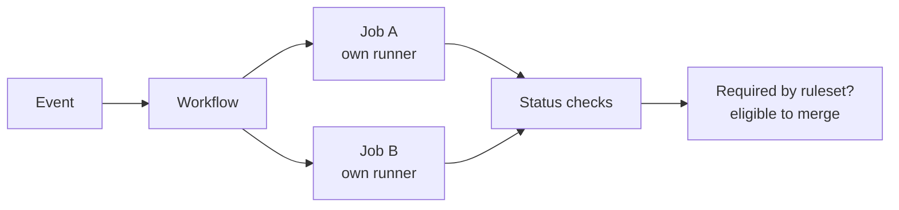
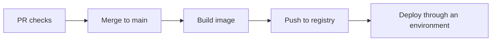

- GitHub Actions is an **event-driven automation engine** attached to a repository
  1. **Event** — something happens in the repo (pull request opened, push)
  2. **Workflow** — YAML that decides when to run and which jobs (`.github/workflows/ci.yml`)
  3. **Job** — one unit of work on a runner. Jobs run in parallel unless `needs` orders them
  4. **Step** — one shell command (`run`) or one action (`uses`), in order, on that job's runner
- The point is early feedback: validate the proposal on the pull request, then build and publish only after merge
- A workflow answers **when and how the pieces fit**. An action answers **how to do one reusable task**

## Mental model



| Concept      | Mental model                         | Example                                     |
| ------------ | ------------------------------------ | ------------------------------------------- |
| **Event**    | What starts automation               | `pull_request`, `push`, `workflow_dispatch` |
| **Workflow** | Pipeline GitHub discovers and runs   | `.github/workflows/ci.yml`                  |
| **Job**      | One unit of work                     | `test`, `validate-pr-title`                 |
| **Runner**   | Machine that executes that job       | `ubuntu-latest` or a self-hosted runner     |
| **Step**     | One command or action inside the job | `npm ci`, `actions/checkout`                |
| **Action**   | Reusable steps packaged for `uses`   | `./.github/actions/check-pr-title`          |

- Steps in a job share one workspace. The next job does not — pass files with **artifacts** (or an external store)
- A failed workflow blocks merge only when branch protection or a ruleset **requires** that check

## Folder layout

```text title='repo layout'
my-app/
├── .github/
│   ├── workflows/
│   │   └── ci.yml                  # workflow — runs when its trigger matches
│   └── actions/
│       └── check-pr-title/
│           └── action.yml          # local action — runs only when a step uses it
├── src/
├── tests/
├── package.json
├── package-lock.json
└── tsconfig.json
```

- Two YAML kinds: a **workflow** is discovered by GitHub; a **local action** is inert until `uses: ./.github/actions/check-pr-title`

## Principles

| Principle                       | In practice                                                                     |
| ------------------------------- | ------------------------------------------------------------------------------- |
| Automate the feedback loop      | PR: lint, test, policy. After merge: build and publish. Deploy a known artifact |
| Orchestration vs reusable logic | `ci.yml` wires jobs. `check-pr-title` owns the title rule                       |
| Deterministic pipelines         | Lockfile + `npm ci`. The same commit should yield the same validated artifact   |
| CI is production infrastructure | Least privilege. Untrusted PR code does not get secrets or a write token        |
| Fail fast, keep the failure     | Cheap checks can run beside tests. A green run means required checks passed     |

## CI workflow

```yaml title='.github/workflows/ci.yml'
name: CI

on:
  pull_request:
    branches: [main]
    types: [opened, synchronize, reopened, edited]
  push:
    branches: [main]

permissions:
  contents: read

jobs:
  validate-pr-title:
    if: github.event_name == 'pull_request'
    runs-on: ubuntu-latest
    permissions:
      contents: read
      pull-requests: read
    steps:
      - uses: actions/checkout@v4
      - uses: ./.github/actions/check-pr-title
        with:
          title: ${{ github.event.pull_request.title }}

  test:
    runs-on: ubuntu-latest
    steps:
      - uses: actions/checkout@v4
      - uses: actions/setup-node@v4
        with:
          node-version: 22
          cache: npm
      - run: npm ci
      - run: npm run lint
      - run: npm test
      - run: npm run build
```

- `pull_request` validates the **proposal**. `push` validates a commit **already on the branch**. `branches: [main]` limits both to `main`
- `validate-pr-title` and `test` are independent. Add `needs: test` on a later job (deploy) when order matters
- `@v4` is a readable skeleton tag. In a sensitive pipeline, pin third-party actions to a reviewed full commit SHA

```yaml title='uses vs run'
- uses: actions/checkout@v4
- run: npm ci
- uses: ./.github/actions/check-pr-title
```

## PR title action

```yaml title='.github/actions/check-pr-title/action.yml'
# Accept `feat(search): add document search`, `fix: handle expired tokens`, `chore!: drop node 18`
# Reject `updates`
name: Check PR title
description: Validate a pull request title
inputs:
  title:
    description: Pull request title to validate
    required: true
runs:
  using: composite
  steps:
    - shell: bash
      env:
        PR_TITLE: ${{ inputs.title }}
      run: |
        pattern='^(feat|fix|docs|chore|refactor|test|build|ci|perf|revert)(\([a-zA-Z0-9._/-]+\))?(!)?: .+'
        if [[ ! "$PR_TITLE" =~ $pattern ]]; then
          echo "::error::Invalid PR title: $PR_TITLE"
          echo "Expected: type(optional-scope): description"
          exit 1
        fi
```

- A **composite** action bundles shell (and other actions) into one `uses` target. Fit for a small internal policy, not for every `npm` script
- Put the title in `env`, then read `$PR_TITLE`. Do not drop `${{ inputs.title }}` straight into the script — PR titles are untrusted and that is a shell injection
- `exit 1` fails the step, the job, and the workflow. `::error::` marks the line in the log

```yaml title='workflow passes context, action owns the rule'
- uses: ./.github/actions/check-pr-title
  with:
    title: ${{ github.event.pull_request.title }}
```

## Which abstraction

| Requirement                        | Use                                   |
| ---------------------------------- | ------------------------------------- |
| `npm test`                         | `run` step                            |
| Checkout or install a toolchain    | Third-party action (`uses`)           |
| Same check in several workflows    | Local composite action                |
| When CI runs                       | Workflow `on:`                        |
| Independent checks                 | Separate jobs (parallel)              |
| Tests before deploy                | `needs`                               |
| Production deploy with an approval | GitHub Environment + protection rules |

## Pitfalls

| Pitfall                              | What actually happens                                                                    |
| ------------------------------------ | ---------------------------------------------------------------------------------------- |
| Mixing up `pull_request` and `push`  | One checks the proposal; the other checks a commit already on the branch                 |
| Expecting jobs to share files        | Each job gets a fresh runner. Use artifacts                                              |
| Red workflow, merge still allowed    | The check is not required by branch protection or a ruleset                              |
| Floating tags on third-party actions | `@v4` can move. Pin a full SHA when the pipeline is security-sensitive                   |
| Slow installs                        | Use the lockfile (`npm ci`) and the setup action's cache; keep independent jobs parallel |

## Path to release



- Actions orchestrates. The image is the artifact. The registry stores it. The deploy system promotes that image, not a rebuild of floating `latest`

## Retain

| Decision                 | Guidance                                                                                             |
| ------------------------ | ---------------------------------------------------------------------------------------------------- |
| Token scope              | `contents: read` unless a job must write contents, packages, or issues                               |
| Same commit, same result | Lockfile and `npm ci`. Promote the artifact you already built                                        |
| Required checks          | Configure the ruleset. A workflow file alone does not block merge                                    |
| New action               | Only when the task is a reusable capability with a clear input. A one-off command stays a `run` step |
