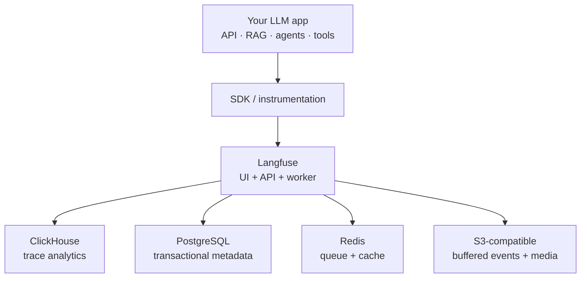
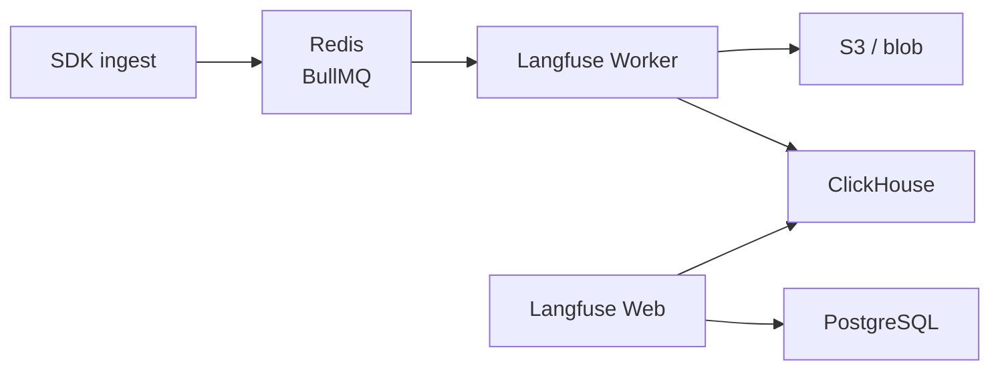

- Treat an LLM app as a normal backend that also needs to **observe probabilistic behavior**
  1. **What it received** — user input, retrieved chunks, tool results
  2. **What it cost / took** — tokens, latency, model used
  3. **Why quality failed** — bad retrieval vs bad generation vs bad prompt
- **Langfuse** is the observability layer: capture and inspect LLM executions (traces, generations, scores)
- From **v3**, Langfuse is ClickHouse-backed for high-throughput tracing/analytics — it did **not** replace Postgres; it uses a **multi-database** stack where each store does what it is best at
- Self-host typically means four infra pieces besides the Langfuse web/worker: **ClickHouse**, **PostgreSQL**, **Redis**, **S3/blob**
- **Docker Compose** runs that stack locally with dependencies and persistent volumes
- App talks to the model provider directly; Langfuse records via SDK/instrumentation — ClickHouse is not your LLM, vector DB, or orchestrator

## Mental model



| Layer          | Job                                                         | Not for                     |
| -------------- | ----------------------------------------------------------- | --------------------------- |
| **App**        | Do the work (retrieve, prompt, generate, tools)             | Storing analytics itself    |
| **Langfuse**   | Tell you what happened; eval / prompt / cost UI             | Being the model             |
| **ClickHouse** | OLAP: high-volume traces, spans, generations, analytics     | Users, API keys, projects   |
| **PostgreSQL** | Transactional state: users, keys, projects, prompts, config | Million-row latency rollups |
| **Redis**      | BullMQ queues + cache; decouple SDK ingest from DB writes   | Long-term trace storage     |
| **S3 / blob**  | Raw ingestion payloads + multimodal media (audio/images)    | Queryable analytics         |

## Core terminology

| Term                  | Mental model                               | Example                            |
| --------------------- | ------------------------------------------ | ---------------------------------- |
| **Trace**             | One end-to-end app execution               | One customer question              |
| **Span**              | A step inside that execution               | `retrieve-documents`               |
| **Generation**        | An LLM call + model/token metadata         | `gpt-4o` · tokens · cost · latency |
| **Observation**       | Recorded unit of work (span or generation) | Any timed step in the UI           |
| **Score / Eval**      | Quality signal                             | Correctness `0–1`, thumbs-up       |
| **Prompt management** | Version prompts used by the app            | `answer-v3` vs `answer-v4`         |

- One question → one **trace** with e.g. three retrieval spans, two generations, one tool call
- A trace separates **retrieval problems** from **generation problems** — wrong chunks ≠ “need a bigger model”

## Why Langfuse

| Need               | What you inspect                                              |
| ------------------ | ------------------------------------------------------------- |
| **Tracing**        | Retrieval → rerank → prompt build → generate → tools          |
| **Latency / cost** | Slow calls, token burn, expensive workflows                   |
| **Debug / eval**   | Prompts, outputs, feedback scores, model/prompt version diffs |

## Why ClickHouse

LLM observability is analytical: many rows with timestamps, models, tokens, latency, attributes.

| Question you want                     | Fit                     |
| ------------------------------------- | ----------------------- |
| Highest average latency by model?     | Column scan + aggregate |
| p95 generation latency?               | Same                    |
| Worst failure rate by prompt version? | Same                    |
| Spend per day?                        | Same                    |
| Retrieval pipeline ↔ poor feedback?   | Same                    |

- **PostgreSQL** → transactional app/metadata data
- **ClickHouse** → large-scale analytical queries
- They solve different problems; one does not replace the other

## How the architecture works together

Langfuse uses **PostgreSQL and Redis in addition to ClickHouse**. The v3 ClickHouse transition added OLAP scale; it kept a multi-DB design instead of collapsing onto one store.

Not “two containers.” Self-host / production typically means:

| Component           | Kind             | What it stores / does                                                                 |
| ------------------- | ---------------- | ------------------------------------------------------------------------------------- |
| **Langfuse Web**    | App              | UI + API                                                                              |
| **Langfuse Worker** | App              | Background ingestion (async)                                                          |
| **ClickHouse**      | OLAP engine      | Heavy observability: high-volume traces, spans, generations, analytics metrics        |
| **PostgreSQL**      | Transactional DB | Primary state: users, API keys, projects, prompt configs, basic system state          |
| **Redis**           | Queue + cache    | BullMQ queues — decouple fast SDK ingestion from DB inserts so spikes don’t choke DBs |
| **S3 / blob**       | Object storage   | Raw ingestion payloads + multimodal media (audio/image attachments on LLM steps)      |



- **Ingest path:** SDK → Redis queue → worker → ClickHouse (+ blob for payloads/media)
- **Control plane:** Web/API reads/writes relational state in PostgreSQL; analytics/trace views lean on ClickHouse
- Exact requirements follow the Langfuse release — use the **official Compose + env template**, not a hand-rolled incomplete stack

## App connection (TypeScript)

Do **not** query ClickHouse from the app to record normal traces. Instrument with the Langfuse SDK (or its OTel path); Langfuse’s backend owns ingestion.

```ts title='RAG steps to instrument'
async function answerQuestion(question) {
  // 1. retrieve — top-k, retrieval latency
  const documents = await vectorStore.search(question);

  // 2. build prompt — context length, prompt version
  const prompt = buildPrompt(question, documents);

  // 3. generate — model, tokens, cost, latency
  const answer = await llm.generate(prompt);

  return { answer, retrievedChunks: documents.length };
}
```

```text title='desired trace shape'
Trace: answer-question
├── retrieve-documents   Top-k · retrieval latency
├── build-prompt         Context length · prompt version
└── generate-answer      Model · tokens · cost · latency
```

## Trade-offs

| Decision                         | Upside                                | Cost / risk                         |
| -------------------------------- | ------------------------------------- | ----------------------------------- |
| **Cloud vs self-host**           | Cloud = less ops; self-host = control | Vendor/data handling vs maintenance |
| **ClickHouse vs Postgres alone** | Efficient large analytical queries    | Extra DB to operate                 |
| **Async ingestion**              | Less overhead on user requests        | Delayed visibility; monitor lag     |
| **Compose vs Kubernetes**        | Simple local / small deploys          | Compose ≠ HA production             |
| **Full prompts vs metadata**     | Richer debug / eval                   | Privacy, PII, storage               |
| **Long vs short retention**      | Trend analysis                        | Storage, cost, governance           |

## Production retain

| Concern         | Guidance                                                                              |
| --------------- | ------------------------------------------------------------------------------------- |
| **Reliability** | Observability outage must not take down the customer LLM path                         |
| **Privacy**     | Redact secrets, PII, sensitive prompts before record                                  |
| **Retention**   | Decide how long traces, scores, media live                                            |
| **Capacity**    | Watch disk, ingestion lag, query latency, memory — size Redis/ClickHouse to avoid OOM |
| **Upgrades**    | Pin compatible versions; back up volumes; follow Langfuse upgrade guide               |
| **Security**    | Private DB ports; strong credentials; secrets outside source control                  |

- Division of responsibility: **app does work** → **Langfuse explains it** → **ClickHouse makes analytics scale** → **Postgres / Redis / object storage** support the pipeline
- LLM observability is more than logging the final answer: inspect the whole execution, correlate quality with latency and cost, then improve systematically
