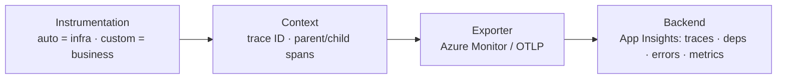

- OpenTelemetry (OTel) is the **standard way to generate, collect, and export telemetry** from your application
  1. **Generate** — create telemetry inside your app (spans, metrics, logs)
  2. **Collect** — gather it in-process (and optionally via a Collector): batch, sample, filter, enrich
  3. **Export** — send it to a backend over a protocol (e.g. OTLP, Azure Monitor exporter)
- Answers: what happened during a request, how long it took, and where it failed
- Instrument once, then choose where to send telemetry (Azure App Insights, Collector, another vendor)

## Mental model — three signals

- Treat a production app as a black box. OTel gives three kinds of evidence:

| Signal      | Answers                                        | Example                                            |
| ----------- | ---------------------------------------------- | -------------------------------------------------- |
| **Traces**  | Where did the request spend its time?          | HTTP → PostgreSQL → LLM call                       |
| **Metrics** | Is the system getting slower or less reliable? | request rate, error rate, p95 latency, queue depth |
| **Logs**    | What happened, and what details explain it?    | validation failed, payment provider timed out      |

- Use **traces** to investigate one request; use **metrics** for counts, rates, and trends across many



## Core terminology

| Term                   | Mental model                          | Example                                  |
| ---------------------- | ------------------------------------- | ---------------------------------------- |
| **Span**               | One timed operation                   | `orders.create`                          |
| **Trace**              | Complete journey of a request         | create → charge → save                   |
| **Span context**       | Identity / correlation                | Trace ID + Span ID                       |
| **Parent/child spans** | Call hierarchy                        | HTTP request contains DB query span      |
| **Propagation**        | Carry trace identity across services  | `traceparent` HTTP header                |
| **Attributes**         | Searchable metadata on a span         | `order.type = "subscription"`            |
| **Events**             | Timestamped occurrences inside a span | `retry.started`                          |
| **Resource**           | Identity of the emitting service      | `service.name = "orders-api"`            |
| **Instrumentation**    | Code that produces telemetry          | HTTP auto-instrumentation / custom spans |
| **Exporter**           | Sends telemetry to a destination      | Azure Monitor exporter                   |
| **Sampling**           | Decide which traces to retain         | Keep a % of requests                     |
| **P95 latency**        | 95% of requests finish within this    | p95 = 200 ms → 5 in 100 are slower       |

- A **span** is the fundamental unit of tracing: start/end time, status, attributes, events, child spans
- Prefer **p95 over averages** — averages hide the slow requests users feel and the bottlenecks behind them

## Trace structure

- Every step in a request shares one **Trace ID**. Each step has its own **Span ID** and points to its parent

```text title='trace & span IDs'
[Trace ID: 00000abc]
└── Place Order        (Root Span ID: 1111)
    ├── Payment Process (Span ID: 2222, Parent: 1111)
    └── Confirm Order   (Span ID: 3322, Parent: 1111)
```

- Parent/child links come from the **active context**: a span started while another is active becomes its child
- Across services, propagation carries the context in the `traceparent` header, so the downstream span joins the same trace

## Project layout

```text title='project layout'
src/
├── telemetry/
│   ├── instrumentation.ts   # initialize OTel / Azure exporter
│   ├── tracing.ts           # custom span helpers
│   └── metrics.ts           # custom business metrics
├── ...
```

- Bootstrap rule: initialize instrumentation **before** importing the libraries you want instrumented
- Instrumentation order:
  1. **Auto-instrumentation** first — broad coverage of HTTP, DB, and other dependencies
  2. **Custom** second — spans and metrics around business operations

## Azure Application Insights setup

1. Create an **Application Insights** resource in the Azure portal
2. Copy the **connection string** from Overview
3. Set `APPLICATIONINSIGHTS_CONNECTION_STRING` (Key Vault / deployment config in prod — never hardcode)
4. Bootstrap the SDK in `instrumentation.ts`, loaded before the app
5. Verify in App Insights: Once data flows, query it in **Logs** with KQL (Kusto Query Language)

```text title='src/telemetry/instrumentation.ts'
useAzureMonitor({
  azureMonitorExporterOptions: {
    connectionString: env.APPLICATIONINSIGHTS_CONNECTION_STRING
  }
})
// import / start the rest of the app only after this runs
```

**Fastest path:** bootstrap → confirm HTTP requests and dependencies appear in App Insights → add custom spans around the highest-value business operations.

## Custom spans

```ts title='src/telemetry/tracing.ts'
tracer = trace.getTracer("orders-service")

traced(name, attributes, operation):
  return tracer.startActiveSpan(name, span =>
    span.setAttributes(attributes)
    try:
      return await operation()
    catch error:
      span.recordException(error)
      span.setStatus({ code: SpanStatusCode.ERROR })
      throw error
    finally:
      span.end()
  )
```

```ts title='usage in service'
handleCreateOrder(orderId):
  return traced("orders.create", { "order.id": orderId }, async () =>
    await saveOrderToDatabase()      // auto-instrumented → child span
    await chargePaymentProvider()    // auto-instrumented → child span
  )
```

- Always **end** spans, **record** errors, and **rethrow** unless business logic handles them
- `startActiveSpan` makes the span active, so nested custom spans and auto-instrumented DB/HTTP calls become its children
- Pass context explicitly only when you start a span outside the active one (`trace.setSpan(context.active(), parent)`)

## Custom metrics

- Use a **Counter** for business events (e.g. orders placed). Add dimensional attributes to slice the totals
- `counter.add(1)` updates a running total in memory; the SDK periodically flushes aggregates to the backend

```ts title='src/telemetry/metrics.ts'
meter = metrics.getMeter("orders-service", "1.0.0")

orderCounter = meter.createCounter("orders_placed_total", {
  description: "Total orders placed",
  unit: "{order}"
})

withOrderMetric(paymentMethod, operation):
  try:
    result = await operation()
    orderCounter.add(1, { "payment.method": paymentMethod, "order.status": "success" })
    return result
  catch error:
    orderCounter.add(1, { "payment.method": paymentMethod, "order.status": "failed" })
    throw error
```

- Keep attribute values **low-cardinality** (`credit_card`, `failed`) — never IDs or emails in metric dimensions

## Collector (optional)

- A **Collector** is a vendor-agnostic proxy that receives, processes, and exports telemetry
- The app sends to the Collector instead of straight to the backend; the Collector filters, scrubs, samples, and routes

| Approach  | How                                 | Best for                                         |
| --------- | ----------------------------------- | ------------------------------------------------ |
| Direct    | App → Azure Monitor exporter        | One backend, simplest setup                      |
| Collector | App → OTLP → Collector → backend(s) | Central processing, scrubbing, multiple backends |

## Hide sensitive data

- Scrub at one of two layers:
  1. **App (SDK)** — before data leaves the process
  2. **Collector** — before data reaches storage
- Restrict auto-instrumentation captures: HTTP, Express, and gRPC instrumentations can record headers and query params — turn those off or allow-list them when registering
- Don't attach passwords, tokens, or payment details as attributes in the first place

```text title='masking rules'
for each finished span, before export:
  if attributes["user.email"]:
    set "user.email" = "REDACTED"
  if attributes["db.statement"]:
    replace /password=\w+/g with "password=***"
```

## Production rules

| Decision            | Guidance                                                           |
| ------------------- | ------------------------------------------------------------------ |
| Auto vs custom      | Auto first; custom spans around business operations                |
| Sampling            | Start with defaults; tune for traffic, diagnostics, ingestion cost |
| Direct vs Collector | Direct = simple; Collector = central processing / multi-route      |
| Sensitive data      | Never attach passwords, tokens, payment details                    |
| Metric dimensions   | Low-cardinality values only                                        |
| Propagation         | Preserve context across HTTP and message queues                    |
| Performance         | Batch telemetry; monitor cost; load-test                           |
| Shutdown            | Flush telemetry on graceful shutdown                               |
