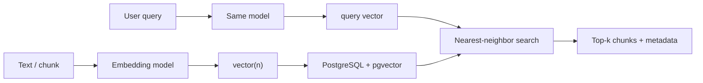

- Embedding model → fixed-length vector; pgvector → store, index, nearest-neighbor retrieve next to relational data
- Split out a dedicated vector DB when retrieval scale / isolation demands compete hard with OLTP

## Mental model



## Core terminology

| Term                      | Mental model                                 | Example                    |
| ------------------------- | -------------------------------------------- | -------------------------- |
| **Embedding**             | Meaning → numbers; O/P: fixed list of floats | 1536-d OpenAI-style vector |
| **Dimension `n`**         | Length of the vector                         | `vector(1536)`             |
| **Distance / similarity** | How far two vectors are under a metric       | Cosine distance `<=>`      |
| **Top-k / NN**            | Closest `k` stored vectors to the query      | `ORDER BY … LIMIT 10`      |
| **Exact search**          | Compare query to (eligible) rows             | No ANN index; ground truth |
| **ANN**                   | Approximate nearest neighbor                 | HNSW, IVFFlat              |
| **Recall@k**              | Fraction of exact top-k recovered by ANN     | 8/10 → 0.8                 |
| **Operator class**        | Ties index to a metric                       | `vector_cosine_ops`        |
| **Reranking**             | Expensive reorder of candidates              | Cross-encoder on top 50    |
| **Quantization**          | Cheaper / smaller vector form                | `halfvec`, spatial         |

## Types & storage

| Type               | Represents              | Prefer when              |
| ------------------ | ----------------------- | ------------------------ |
| **`vector(n)`**    | float32 dense           | Default starting point   |
| **`halfvec(n)`**   | float16 dense           | Cut storage / index RAM  |
| **`sparsevec(n)`** | Sparse nonzero features | Sparse models / features |

- Rough dense payload: **≈ `4n + 8` bytes** per `vector` (excludes table/index/WAL overhead)
- Example: `n=1536` → ~6 KB/vector → ~31 GB payload for 5M rows before indexes/metadata

```sql title='enable + schema'
CREATE EXTENSION IF NOT EXISTS vector;

CREATE TABLE document_chunks (
  id          bigint GENERATED ALWAYS AS IDENTITY PRIMARY KEY,
  tenant_id   bigint NOT NULL,
  document_id bigint NOT NULL,
  chunk_index integer NOT NULL,
  content     text NOT NULL,
  metadata    jsonb NOT NULL DEFAULT '{}',
  embedding   vector(1536) NOT NULL,
  created_at  timestamptz NOT NULL DEFAULT now(),
  UNIQUE (document_id, chunk_index)
);

CREATE INDEX document_chunks_tenant_idx ON document_chunks (tenant_id);
```

## Distance metrics

Match **model training**, **index ops class**, and **SQL operator** — mismatch → “SQL works, answers feel wrong.”

| Metric              | Operator | Intuition              | Notes                      |
| ------------------- | -------- | ---------------------- | -------------------------- |
| **Cosine distance** | `<=>`    | Direction difference   | Common for text embeddings |
| **L2 / Euclidean**  | `<->`    | Straight-line distance | Sensitive to magnitude     |
| **L1 / Manhattan**  | `<+>`    | Sum of abs diffs       | Specialized reps           |

```sql title='exact nearest neighbors'
SELECT id, content, embedding <=> $1::vector AS distance
FROM document_chunks
WHERE tenant_id = $2
ORDER BY embedding <=> $1::vector
LIMIT 10;
```

| Exact                                                            | Approximate (ANN)       |
| ---------------------------------------------------------------- | ----------------------- |
| Returns every true nearest neighbor under the metric and `WHERE` | May miss true neighbors |
| Often slow at millions of rows                                   | Much faster at scale    |
| No ANN index required                                            | Needs HNSW or IVFFlat   |

## Indexes: HNSW vs IVFFlat

- B-trees excel at equality/ranges on scalars — **not** high-d nearest neighbor. Use ANN indexes.
- **HNSW** (_Hierarchical Navigable Small World_) — multi-layer graph → long-range jumps on upper layers, then refine downstairs
- **IVFFlat** (_Inverted File with Flat vectors_) — cluster vectors into lists → probe only a few lists at query time

```text title='HNSW shape'
layer 2 (sparse, long links):   A --------→ D
                                 │           │
layer 1:                        A → B → C → D → E
                                 │   │   │   │   │
layer 0 (all vectors):   …–v1–v2–A–B–C–D–E–v3–…
query path: enter high → jump far → drop layers → walk neighbors
Analogy: much like zooming in on a digital map.
```

```text title='IVFFlat shape'
            query q
               │
        pick nearest centroids
               │
     ┌─────────┼─────────┐
     ▼         ▼         ▼
  list 3    list 7    list 12     ← probes = 3
  (vecs)    (vecs)    (vecs)
     │         │         │
     └──── scan only these ────→ top-k
(other lists skipped)
```

```sql title='HNSW (cosine)'
CREATE INDEX document_chunks_embedding_hnsw
ON document_chunks
USING hnsw (embedding vector_cosine_ops)
WITH (m = 16, ef_construction = 64);

BEGIN;
SET LOCAL hnsw.ef_search = 100;
SELECT id, content
FROM document_chunks
ORDER BY embedding <=> $1::vector
LIMIT 10;
COMMIT;
```

| Param                 | What it does                                                            | Raise when…               | Cost                  |
| --------------------- | ----------------------------------------------------------------------- | ------------------------- | --------------------- |
| **`m`**               | How many neighbor links each vector keeps per layer (graph density)     | Need higher graph quality | Bigger index / RAM    |
| **`ef_construction`** | How widely the builder explores when wiring a new vector into the graph | Want better build quality | Slower builds/inserts |
| **`hnsw.ef_search`**  | How many candidates the query walk considers before picking top-k       | Recall too low            | Higher latency        |

```sql title='IVFFlat (cosine)'
-- Build after a representative load of data
CREATE INDEX document_chunks_embedding_ivfflat
ON document_chunks
USING ivfflat (embedding vector_cosine_ops)
WITH (lists = 100);

BEGIN;
SET LOCAL ivfflat.probes = 10;
SELECT id, content
FROM document_chunks
ORDER BY embedding <=> $1::vector
LIMIT 10;
COMMIT;
```

| Param                | What it does                                                    | Raise when…                   | Cost                      |
| -------------------- | --------------------------------------------------------------- | ----------------------------- | ------------------------- |
| **`lists`**          | How many clusters the corpus is partitioned into at index build | Want finer partitions to tune | More structure + tuning   |
| **`ivfflat.probes`** | How many of those clusters a query actually scans               | Recall too low                | Latency ↑, recall often ↑ |

| Dimension    | HNSW            | IVFFlat                |
| ------------ | --------------- | ---------------------- |
| Structure    | Graph           | Clusters               |
| Build        | Often slower    | Often faster           |
| Memory       | Often higher    | Often lower            |
| Default pick | Low-latency ANN | Lower-memory / explore |

**Optimization loop:** exact baseline → ANN → measure **Recall@k** + p95 latency → raise `ef_search` / `probes` → remeasure (include filtered queries).

## Metadata filtering

Adding `WHERE tenant_id = $2` to an HNSW query often **silently returns fewer than `LIMIT`** (even 0) while that tenant still has plenty of relevant rows.

```text title='post-filtering problem'
1. HNSW walks the global graph → gathers ef_search candidates
2. THEN applies WHERE tenant_id = $2 to those candidates
3. Non-matching tenants dropped → LIMIT 10 may become 1–2 or empty
```

- A plain **B-tree on `tenant_id` does not fix** this — planner picks **one** index for the heavy lift
  1. Large tenant → uses HNSW, ignores B-tree → same post-filter truncation
  2. Tiny tenant → uses B-tree, exact-sorts vectors in memory → accurate but skips ANN (slow as that tenant grows)
- You **cannot** make a composite HNSW like `USING hnsw (tenant_id, embedding)` — HNSW indexes a **vector distance graph**, not a multi-column key; `tenant_id` is equality/filter data and has no place in that graph

| Workload                                  | Starting point                                |
| ----------------------------------------- | --------------------------------------------- |
| Ad-hoc / mixed filters                    | Iterative HNSW scan                           |
| Few large / VIP tenants                   | Partial HNSW indexes                          |
| High-scale multi-tenant                   | Partition by `tenant_id` + HNSW per partition |
| Very selective filter, small eligible set | B-tree filter + exact vector rank             |

```sql title='iterative HNSW scan'
BEGIN;
SET LOCAL hnsw.ef_search = 100;
SET LOCAL hnsw.iterative_scan = relaxed_order;  -- keep walking until LIMIT + WHERE satisfied

SELECT id, content
FROM document_chunks
WHERE tenant_id = $2
ORDER BY embedding <=> $1::vector
LIMIT 10;
COMMIT;
-- Trade-off: sparse tenants / scattered matches → longer hunt
```

```sql title='partial HNSW (few big tenants)'
CREATE INDEX doc_chunks_tenant_42_hnsw
ON document_chunks
USING hnsw (embedding vector_cosine_ops)
WHERE (tenant_id = 42);
-- Query with WHERE tenant_id = 42 can use this tenant-only graph
-- Does not scale to hundreds/thousands of dynamic tenants (write cost)
```

```sql title='partition by tenant'
-- Like a filing cabinet: parent = routing desk; each partition = one drawer
CREATE TABLE document_chunks (          -- parent: virtual blueprint; app SELECTs/INSERTs here; stores no rows itself
  id bigint GENERATED ALWAYS AS IDENTITY,
  tenant_id bigint NOT NULL,            -- partition key: every read/write uses this to pick a drawer
  content text NOT NULL,
  embedding vector(1536) NOT NULL
) PARTITION BY LIST (tenant_id);        -- LIST = exact value match (not date range / hash)

CREATE TABLE chunks_tenant_42           -- child: physical table for tenant 42's rows only
  PARTITION OF document_chunks FOR VALUES IN (42);

CREATE INDEX ON chunks_tenant_42
  USING hnsw (embedding vector_cosine_ops)
  WITH (m = 16, ef_construction = 64);
-- WHERE tenant_id = 42 → partition prune → HNSW only on that tenant's graph
```

## Hybrid search & reranking

- Vectors miss exact codes (`ERR_AUTH_403`), versions, rare IDs — **FTS / lexical** catches them
- Keywords miss paraphrase — **vectors** catch them
- Fuse lexical + vector candidate lists (table below); **rerank is optional** afterward

| Fusion                           | How it combines                                                           | Mental model                                                                 |
| -------------------------------- | ------------------------------------------------------------------------- | ---------------------------------------------------------------------------- |
| **RRF** (Reciprocal Rank Fusion) | Ignores raw scores; uses only list **position**                           | #2 in FTS + #5 in vector → strong combined score because both lists liked it |
| **Score normalization**          | Map both score spaces to a shared scale (e.g. 0–1), then weighted average | e.g. 0.7 × vector + 0.3 × keyword                                            |
| **Union**                        | Pool top-N from each list, drop duplicates                                | Top 50 FTS ∪ top 50 vector → ≤100 candidates                                 |

```text title='two-stage retrieval (rerank optional)'
Stage 1  ANN ± FTS → top 50–100  (optimize recall; required)
Stage 2  Cross-encoder rerank → top 5–10  (optimize precision; optional)
```

- **Rerank** (optional) — a slow, accurate **cross-encoder** re-scores a small candidate batch; too expensive to scan the whole corpus, so it only runs on ~top 50–100 from stage 1
  1. When — right doc is in the top ~50 but not the top 5; to optimize content size
  2. Why — ANN is fast because it compromises; a cross-encoder is deeper relevance but only on a handful of docs
  3. What — pairs the original query with each candidate side-by-side, re-scores exact relevancy, resorts so best rise to #1–#10
  4. Limit — cannot revive a doc stage 1 never returned; candidate recall still matters

```sql title='lexical candidate set'
CREATE INDEX document_chunks_content_fts
ON document_chunks USING gin (to_tsvector('english', content));

SELECT id, content,
       ts_rank(to_tsvector('english', content),
               plainto_tsquery('english', $1)) AS text_score
FROM document_chunks
WHERE to_tsvector('english', content) @@ plainto_tsquery('english', $1)
ORDER BY text_score DESC
LIMIT 20;
```

## Embedding versions

Do not overwrite in place — use **dual-write / blue-green** so search keeps working and you can roll back.

```text title='cutover steps'
1. Add embedding_v2 column (leave unindexed while writing)
2. Dual-write: new/updated docs → both models; searches still use v1
3. Backfill rows where embedding_v2 IS NULL (batched worker)
4. Build ANN on v2 (depends on business or whether v1 has index)
5. Flip to v2; keep v1 for instant rollback
6. After confidence window → drop v1 index + column; reclaim space
```

```sql title='add v2 column'
ALTER TABLE document_chunks
ADD COLUMN embedding_v2 vector(384);  -- e.g. 1536 → 384; do not drop v1 yet
-- Skip HNSW/IVFFlat on v2 until backfill finishes (faster writes)
```

```sql title='cleanup after stable window'
DROP INDEX doc_chunks_v1_hnsw;
ALTER TABLE document_chunks DROP COLUMN embedding_v1;
VACUUM FULL document_chunks;  -- reclaim disk; prefer low-traffic window
```

## Verify

```sql title='confirm ANN plan'
EXPLAIN (ANALYZE, BUFFERS)
SELECT id, content
FROM document_chunks
ORDER BY embedding <=> $1::vector
LIMIT 10;
-- Expect Index Scan using …_hnsw / …_ivfflat, not Seq Scan
```

Common planner misses:

1. Ops class ≠ query operator (cosine index + L2 `ORDER BY`)
2. `LIMIT` missing → planner less likely to use ANN
3. Over-selective filter → few ANN survivors (iterative scan / exact-on-subset)
4. IVFFlat built on empty / non-representative data
   - Rule of Thumb: Must wait until you have a realistic sample of your production data (ideally at least 10,000–100,000 rows) before running CREATE INDEX.

## Retain

| If your problem is…            | Start with…                              |
| ------------------------------ | ---------------------------------------- |
| Store dense embeddings         | `vector(n)`                              |
| Correct NN baseline            | Exact search                             |
| Low-latency ANN                | HNSW                                     |
| Lower-memory ANN               | IVFFlat                                  |
| HNSW recall low                | Raise `ef_search`, benchmark             |
| IVFFlat recall low             | Raise `probes`, revisit `lists`          |
| Filtered ANN returns too few   | Iterative scans / filter-aware design    |
| Tiny eligible subset           | Exact over filtered rows                 |
| Few hot categories             | Partial indexes                          |
| Large independent tenants      | Partitioning                             |
| Exact IDs / error codes        | FTS / lexical                            |
| Semantic + lexical both matter | Hybrid (RRF / fused scores)              |
| Good candidates, bad order     | Rerank                                   |
| Vectors too large              | `halfvec` / binary + rerank              |
| Model change                   | Versioned backfill + cutover             |
| Search starves OLTP            | Pooling, isolation, maybe separate infra |

**Five principles**

1. Model creates vectors; pgvector retrieves them — different jobs
2. Exact search first; then trade measured recall for speed
3. Tune HNSW/IVFFlat from metrics, not folklore
4. Filters / tenancy are first-class (security + recall)
5. Index quality ≠ RAG quality — chunks, hybrid, rerank, ACL still matter
