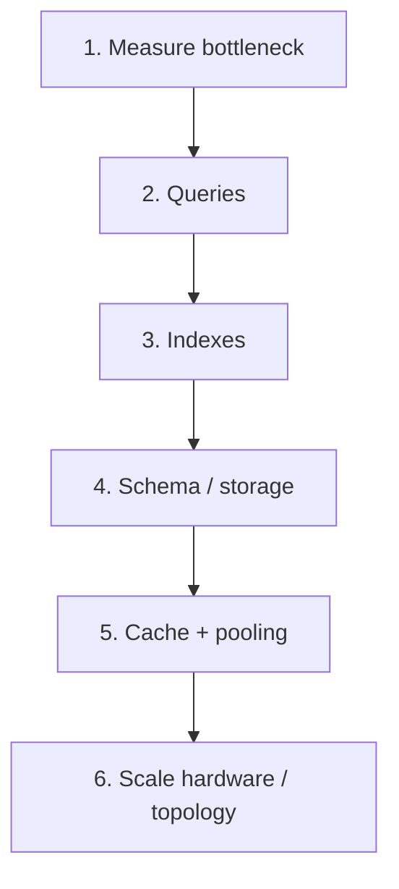

- Database performance work is a **ladder**: measure first, then fix the cheapest layer that actually hurts
- Order matters — do not buy hardware for a bad query, or shard for a missing index
- Most slowdowns are **query shape + missing/wrong indexes**, not CPU
- Connections are expensive → **pool**; hot immutable reads → **cache**; only then **scale out**
- Every change should show up in `EXPLAIN ANALYZE` (or equivalent) before/after

## Mental model

| Layer            | Fix when…                                     | Cheap win examples                      |
| ---------------- | --------------------------------------------- | --------------------------------------- |
| **Measure**      | You cannot name the slow statement            | `EXPLAIN ANALYZE`, wait/CPU/IO metrics  |
| **Queries**      | Plan is bad or you issue too many round-trips | Drop `SELECT *`, kill N+1, bulk DML     |
| **Indexes**      | Seq scans on filtered/joined columns          | Key + composite indexes; drop unused    |
| **Schema**       | Tables too wide/hot or joins dominate         | Tight types, partition, archive, denorm |
| **Cache / pool** | Same read hammered; connect storms            | Redis, PgBouncer, short transactions    |
| **Scale**        | Software ladder exhausted                     | Bigger box → replicas → shards          |

## Core terminology

| Term                  | Mental model                                          | Example                                     |
| --------------------- | ----------------------------------------------------- | ------------------------------------------- |
| **Bottleneck**        | The scarce resource that limits throughput/latency    | Slow query, lock waits, disk IO, pool empty |
| **`EXPLAIN ANALYZE`** | Run the query and show real timings + row estimates   | Prefer over guessing from `EXPLAIN` alone   |
| **N+1**               | 1 list query + N follow-ups per row                   | Posts then one comments query per post      |
| **Connection pool**   | Reuse open DB sessions instead of connect-per-request | PgBouncer in front of Postgres              |
| **Read replica**      | Copy of primary used for reads                        | Offload reporting / search                  |
| **Shard key**         | Field that decides which physical shard owns a row    | `country_code`, `tenant_id`                 |

## 1. Measure first

- **`EXPLAIN ANALYZE`** executes the statement and returns real time / rows; use it before and after each change
- Watch for: sequential scans on large tables, huge row estimates vs actuals, lock waits, pool exhaustion

## 2. Queries

- Inefficient SQL / ORM usage is the most common cause of slowness
- **Avoid `SELECT *`** — fetch only columns you need (less IO, better index-only plans)
- **Filter early** — push `WHERE` predicates before heavy joins when the planner needs help
- **Bulk DML** — prefer set-based `UPDATE` / `INSERT` / `DELETE` over row-by-row loops
- **Fix N+1**:
  1. Problem: 1 query for the list, then N queries for related rows
  2. Fix A: one SQL `JOIN` (single round-trip)
  3. Fix B: ORM eager load → typically 2 queries using `IN (...)`

## 3. Indexes

- An index is a **lookup structure** (usually B-tree) so the engine need not scan the whole table
- Index columns used in **`WHERE`**, **`JOIN`**, **`ORDER BY`**, **`GROUP BY`**
- Prefer a **composite index** that matches a common multi-column filter / sort order
- **Drop unused indexes** — each one costs write latency and storage

## 4. Schema and storage

- Layout decides how much work each query does
- **Tight types** — smaller rows → more rows per page → better cache hit rate (`int` vs `bigint` when range allows)
- **Partition** large tables by a logical range (date, region) so scans touch less data
- **Archive** cold history out of the hot table
- **Denormalize** a field only when a hot read path pays too much for the join — and own the sync cost

## 5. Cache and connections

- Work _outside_ the DB when the same cheap answer is hammered repeatedly
- **External cache** (e.g. Redis) for repetitive, slowly changing lookups
- **Connection pool** (e.g. PgBouncer) — reuse sessions; do not open one connection per HTTP request
- **Keep transactions short** — long txns hold locks/snapshots and block others

## 6. Scale infrastructure

- Scale only after the software ladder stops helping

| Approach          | What it is                                      | Best for                            |
| ----------------- | ----------------------------------------------- | ----------------------------------- |
| **Vertical**      | Bigger CPU / RAM / disk on one node             | Simple first hardware step          |
| **Read replicas** | Primary writes; copies serve reads              | Read-heavy apps, reporting offload  |
| **Sharding**      | Split data across separate servers by shard key | Write + data volume beyond one node |

### Read replication

- **Primary** — accepts writes; source of truth
- **Replicas** — copies used for reads; improve availability and read scale
- Propagation is **sync** or **async**:

| Mode             | Behavior                                              | Tradeoff                                       |
| ---------------- | ----------------------------------------------------- | ---------------------------------------------- |
| **Synchronous**  | Primary waits for replica ACK before commit returns   | Stronger durability; higher write latency      |
| **Asynchronous** | Primary commits immediately; replica catches up later | Faster writes; possible lag / loss on failover |

### Sharding

- Split one logical database into **shards** on separate machines
- App (or **shard router**) reads the **shard key** from the query and opens a connection to the owning shard
- Cross-shard query (e.g. “total sales worldwide”) must **fan out** to every shard and merge — slow and fragile
