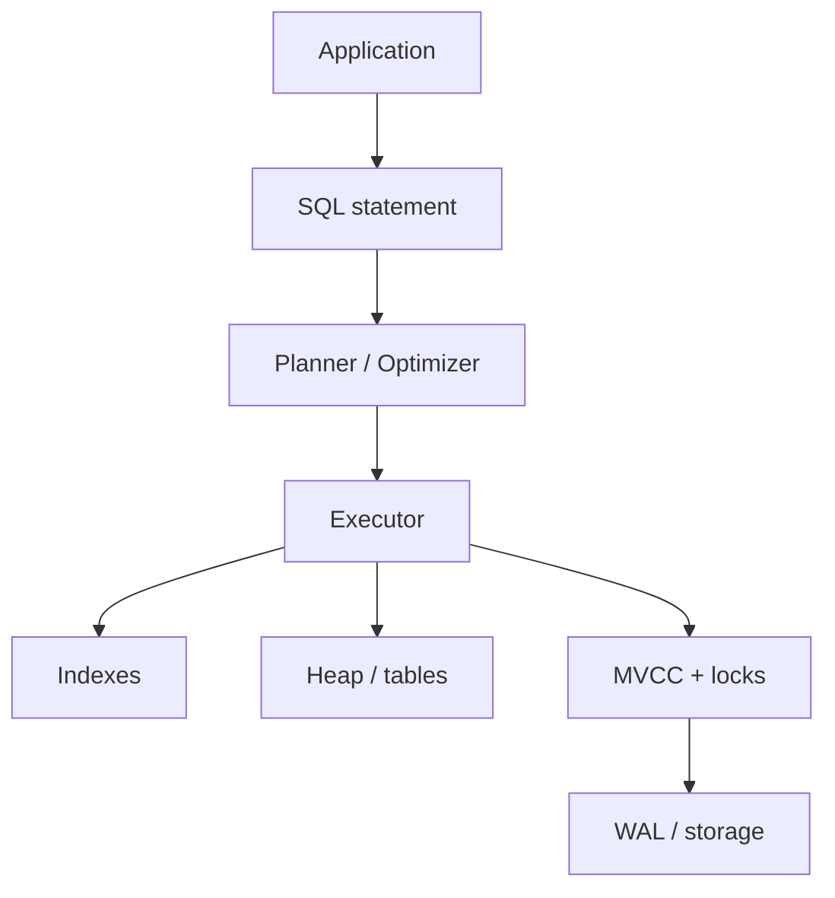

- PostgreSQL is a **concurrent, transactional computation engine** — not just a place to store application objects
- Senior questions shift from “how do I write this query?” to **why is it slow, what happens under concurrency, which index**
- Schema + constraints encode **invariants**; indexes + planner encode **access paths**; MVCC + locks encode **concurrency**; WAL encodes **durability**
- Every statement goes: **Parse → Analyze → Rewrite → Plan → Execute** — understanding _why_ the plan was chosen matters more than memorizing syntax
- Put rules that must survive application bugs in the database when practical (`NOT NULL`, `UNIQUE`, `FK`, `CHECK`)
- Connections are expensive → **pool** (size ≠ “as many as possible”).

## Mental model



| Layer            | Job                                    | Failure mode if ignored       |
| ---------------- | -------------------------------------- | ----------------------------- |
| **SQL / schema** | Relations + invariants                 | Silent corruption in app      |
| **Planner**      | Choose access path + join strategy     | Wrong index / seq scan blowup |
| **MVCC**         | Readers don’t block writers (versions) | Bloat, surprise visibility    |
| **Locks**        | Serialize conflicting writers          | Races, deadlocks, waits       |
| **WAL**          | Durable log before data pages          | Lost commits, bad recovery    |

## Core terminology

| Term                  | Mental model                                     | Example                                       |
| --------------------- | ------------------------------------------------ | --------------------------------------------- |
| **Relation / table**  | Set of tuples + constraints                      | `users`, `orders`                             |
| **MVCC**              | Row = versions over time, not one mutable object | UPDATE → new tuple, old becomes dead          |
| **Snapshot**          | Which row versions a statement/txn can see       | Isolation level                               |
| **Dead tuple**        | Old version no longer visible                    | Needs VACUUM reuse                            |
| **WAL**               | Log change first, flush data pages later         | Crash recovery, replication, PITR             |
| **B-tree index**      | Sorted tree for `=`, ranges, `ORDER BY`          | `CREATE INDEX ON users(email)`                |
| **EXPLAIN ANALYZE**   | Actually run + show real timings/rows            | Prefer over guessing                          |
| **FOR UPDATE**        | Lock selected rows for write                     | Inventory / wallets                           |
| **SKIP LOCKED**       | Take unlocked rows; skip contended ones          | Worker queues                                 |
| **Keyset pagination** | Seek past last key instead of OFFSET             | `WHERE id > $last LIMIT 20`                   |
| **Outbox**            | Persist event in same txn as state change        | save order and then add email event to outbox |

## Modeling & invariants

- Schema describes **relationships and invariants**, not app objects
- **Invariant** = a fact that must always stay true, even if the app has a bug — e.g. email unique, `stock >= 0`, order must belong to a user, only `pending` → `paid`. Encode these as constraints (`NOT NULL`, `UNIQUE`, `FK`, `CHECK`) when the DB can enforce them
- Type / modeling tradeoffs:

| Choice                           | Prefer when                                      | Tradeoff                                                                             |
| -------------------------------- | ------------------------------------------------ | ------------------------------------------------------------------------------------ |
| **`bigint` IDENTITY**            | Local PKs                                        | Compact, ordered, good locality                                                      |
| **UUID**                         | Global / distributed identity                    | Larger indexes, less locality, harder to enumerate                                   |
| **`text`**                       | Variable strings; no real length rule            | Default in Postgres; pair with `CHECK (length(...))` if needed                       |
| **`varchar(n)`**                 | You _must_ enforce a hard max length in the type | Same storage as `text` under the hood; `n` is mostly a constraint                    |
| **`enum`**                       | Tiny, frozen set of labels rarely changed        | Altering values = schema migration; awkward across envs                              |
| **Lookup / reference table**     | Labels change, need metadata, or soft-delete     | Extra join; values are data — migrate without DDL                                    |
| **`numeric(p,s)`** e.g. `(12,2)` | Money / exact decimals                           | Exact; slightly slower than float                                                    |
| **`float` / `double`**           | Science, stats, approx measurements              | rounding — **never** for currency; Blazing fast (Processed by physical CPU hardware) |
| **Integer cents**                | High-volume money math in app                    | Exact; you own scaling (`cents` / 100)                                               |

- Application validation improves UX; **DB constraints protect correctness**

```sql title='skeleton with invariants'
CREATE TABLE users (
  id         bigint GENERATED ALWAYS AS IDENTITY PRIMARY KEY,
  email      text NOT NULL UNIQUE,
  name       text NOT NULL,
  created_at timestamptz NOT NULL DEFAULT now()
);

CREATE TABLE orders (
  id         bigint GENERATED ALWAYS AS IDENTITY PRIMARY KEY,
  user_id    bigint NOT NULL REFERENCES users(id),
  status     text NOT NULL CHECK (status IN ('pending','paid','cancelled')),
  total      numeric(12,2) NOT NULL CHECK (total >= 0),
  created_at timestamptz NOT NULL DEFAULT now()
);
```

## NULL & three-valued logic

- `NULL` ≈ unknown / missing — **not** a value; `NULL = NULL` → `UNKNOWN`
- `WHERE` keeps only rows where the condition is **TRUE**
- Use `IS NULL` / `IS NOT NULL`, never `= NULL`

## Conditional Expressions & Operators

| Expression     | Job                                           | Example                                            |
| -------------- | --------------------------------------------- | -------------------------------------------------- |
| **`CASE`**     | Branch on conditions or equality              | Map status → label; pick column by rule            |
| **`COALESCE`** | First non-NULL arg                            | Fallback: `COALESCE(nickname, name, 'anon')`       |
| **`IS NULL`**  | Predicate: is value missing? (not a function) | `WHERE email IS NULL` — Postgres has no `ISNULL()` |
| **`NULLIF`**   | Return NULL if args equal; else first arg     | Treat sentinel as missing: `NULLIF(x, '')`         |
| **`CAST`**     | Convert type (`CAST(x AS t)` or `x::t`)       | `amount::numeric`, `CAST('2024-01-01' AS date)`    |

```sql title='CASE / COALESCE / NULLIF / CAST'
-- searched CASE (conditions)
SELECT
  id,
  CASE
    WHEN total >= 1000 THEN 'vip'
    WHEN total >= 100  THEN 'regular'
    ELSE 'new'
  END AS tier
FROM orders;

-- simple CASE (equality on one expression)
SELECT CASE status
  WHEN 'pending'   THEN 1
  WHEN 'paid'      THEN 2
  WHEN 'cancelled' THEN 3
END AS status_rank
FROM orders;

-- COALESCE: first non-NULL
SELECT COALESCE(preferred_name, full_name, 'unknown') AS display_name
FROM users;

-- NULLIF: turn a sentinel into NULL (pairs well with COALESCE)
SELECT COALESCE(NULLIF(trim(nickname), ''), full_name) AS display_name
FROM users;

-- CAST / ::
SELECT CAST(total AS text), total::int, '42'::integer;
```

- For “is missing?” use **`IS NULL`**, not `= NULL`
- `NULLIF(a, b)` is the inverse of a common `COALESCE` pattern: invent NULL so a later fallback can kick in

## Query mental model

Logical evaluation order (not left-to-right typing):

```text title='SELECT evaluation order'
FROM → JOIN → WHERE → GROUP BY → HAVING → SELECT → DISTINCT → ORDER BY → LIMIT
```

| Join      | Keeps                             |
| --------- | --------------------------------- |
| **INNER** | Matching rows only (`A ∩ B`)      |
| **LEFT**  | All of A + matching B (or NULL B) |
| **CROSS** | Every A × every B                 |

- Prefer **`EXISTS` / `NOT EXISTS`** for “does a match exist?” over join-then-dedupe; avoid `NOT IN` when NULLs can appear
- **`GROUP BY` collapses** rows; **window functions preserve** rows and add columns (`SUM(...) OVER (PARTITION BY ...)`)
  - Imagine you have a table of employees, their departments, and their salaries
  - Group By (Collapses Rows): GROUP BY department collapses individual identities. You only get one row per department.
  - Window Function (Preserves Rows, Adds Columns): calculates exact same mathematical sum, but it keeps every single row intact
  - `SELECT employee_name, department, SUM(salary) OVER (PARTITION BY department) as dept_total_salary FROM employees;`
- Latest-per-group: `ROW_NUMBER() ... WHERE rn = 1`, or Postgres-specific `DISTINCT ON (user_id) ... ORDER BY user_id, created_at DESC`
  - problem: you want to extract only the single most recent record for each specific entity
  - `ROW_NUMBER()`: use window function to temporarily assign a sequential rank to each row within a isolated "grouping" of data
- CTEs improve readability; PG may inline them — use `AS MATERIALIZED` / `NOT MATERIALIZED` when you need control
  - CTE (Common Table Expression) is a temporary result set that you define using a `WITH` clause at the start of your query
  - A junior approach uses deeply nested subqueries, which read from the "inside out" and are incredibly hard for humans to follow.
  - NOTE: If your main query only wanted `LIMIT 10`, Postgres would still calculate all 1 million rows inside the CTE first.
  - Behind-the-scene: PG treats the CTE just like a subquery /inline. PG rewrites into one giant query for optimization
  - PG gives two manual overrides to force its behavior: `AS MATERIALIZED` (Force a freeze) & `AS NOT MATERIALIZED` (Force inlining)
  - `AS MATERIALIZED` (Force a freeze):
    - This forces Postgres to calculate the CTE entirely on its own first, cache the result, and block the main query from messing with its execution.
    - **Why use it:** If CTE is incredibly slow, you don't want the outer query trying to evaluate it multiple times during a complex join. Forcing it to materialize calculates it exactly once.
  - `AS NOT MATERIALIZED` (Force inlining):
    - This forces Postgres to dismantle the CTE and blend it completely into the main query, even if the query planner was leaning toward caching it.
    - **Why use it:** You want PG to use a composite index (inner and outer query has different WHERE clause).

```sql title='latest by group
-- Method 1: The Standard Way (ROW_NUMBER())
-- Standard SQL. Works on MySQL, SQL Server, Oracle, etc.
WITH ranked_orders AS (
    SELECT order_id, user_id, amount, created_at,
           ROW_NUMBER() OVER (PARTITION BY user_id ORDER BY created_at DESC) as rn
    FROM orders
)
SELECT order_id, user_id, amount, created_at
FROM ranked_orders
WHERE rn = 1;

-- Method 2: The Postgres Superpower (DISTINCT ON)
SELECT DISTINCT ON (user_id) order_id, user_id, amount, created_at
FROM orders
ORDER BY user_id, created_at DESC;
-- DISTINCT ON (user_id) tells Postgres: "Look at rows with duplicate user_ids, and only return the first row you encounter for each unique id."
-- The Trick: Because it grabs the first row it encounters, we use the ORDER BY clause to manipulate which row is at the front of the line.
-- composite index:
-- CREATE INDEX idx_orders_user_created ON orders (user_id, created_at DESC);
-- This index allows Postgres to skip sorting entirely, instantly plucking the latest row for each user off the disk.
```

## Indexes

An index trades **write cost, storage, maintenance, cache** for **faster access paths**

| Type / pattern         | Best for                                                                     |
| ---------------------- | ---------------------------------------------------------------------------- |
| **B-tree** (default)   | `=`, ranges, `ORDER BY`                                                      |
| **Partial**            | Hot subset: `WHERE status = 'pending'`                                       |
| **Composite**          | `WHERE a = ? ORDER BY b` — column order matters                              |
| **Leftmost prefix**    | `(a,b,c)` helps `a`, `a+b`, `a+b+c` — not bare `b` alone as a starting model |
| **Expression**         | `WHERE lower(email) = ...` → index `lower(email)`                            |
| **INCLUDE / covering** | Payload columns for index-only scans                                         |
| **GIN**                | JSONB, arrays, Full-Text-Search (`token → many rows`)                        |

- INCLUDE / covering:
  - The Problem: The Cost of the "Heap Fetch". If you only have a normal index on username, PG will:
    1. Look up 'alice' in the username index to find the exact physical address of her row.
    2. Go to the actual table (the heap) to pluck the email and user_id values out of that row.
  - Going back to the table is expensive. If your query returns thousands of rows, making thousands of separate trips to the table disk blocks causes significant I/O bottlenecks
  - Solution: You tell PG to attach email and user_id columns (payload data) directly to the index itself. This turns it into a covering index.
  - Cons: Index Size and Bloat - makes B-Tree structure much more complex, wider, and slower to traverse.
- GIN (Generalized Inverted Index):
  - Problem with Normal Indexes (B-Tree): it treats data as a single, solid value
  - Solution: GIN breaks open array container, extracts individual elements, and maps each element back to the rows that contain it
  - E.g: `SELECT * FROM products WHERE tags @> ARRAY['electronics', 'work'];`
  - GIN looks up rows for 'electronics' and 'work'. Then performs AND operation to find the overlapping row ids.
  - Trade-off: GIN Write Performance. They are slow to update.

```sql title='access-path indexes'
CREATE INDEX idx_orders_user_created
  ON orders(user_id, created_at DESC);

CREATE INDEX idx_orders_pending
  ON orders(created_at)
  WHERE status = 'pending';

CREATE INDEX idx_users_email_lower
  ON users(lower(email));

CREATE INDEX idx_users_email_covering
  ON users(email) INCLUDE (id, created_at);
```

## Query plans

```sql title='explain safely'
EXPLAIN SELECT * FROM orders WHERE user_id = 42; -- guess

BEGIN;
EXPLAIN ANALYZE DELETE FROM orders WHERE ...;  -- actually runs
ROLLBACK;
-- prints out a tree of operational steps called Nodes.
```

- A senior engineer reads this tree from the bottom up, asking five critical questions of each individual node:
  1. What node is this?: Data access or Join node
  2. Estimated vs Actual rows?: Did the query planner guess correctly? A huge mismatch means outdated statistics
     - Huge **estimated vs actual** mismatch → stale/bad stats → `ANALYZE`; don’t “just add an index” first.
  3. Time?: How many milliseconds were spent inside this specific step
  4. Loops?: How many times was this node executed
  5. I/O?: Did it read from memory (shared hit) or slow disk (read)
- Data access nodes (how PG reads one table before joins):

| Node                | How                                                          | Best for                                |
| ------------------- | ------------------------------------------------------------ | --------------------------------------- |
| **Seq Scan**        | Read whole table                                             | Small tables / high % of rows (~>20%)   |
| **Index Scan**      | Index → row pointer → heap fetch                             | Few selective rows from a large table   |
| **Index Only Scan** | All needed columns in the index (e.g. `INCLUDE`) — skip heap | Covering indexes; fastest when possible |

- Join nodes (outer = first dataset, inner = second):

| Node            | How                                            | Best for                    | Watch out                                      |
| --------------- | ---------------------------------------------- | --------------------------- | ---------------------------------------------- |
| **Nested Loop** | For each outer row, look up matches in inner   | Small outer + indexed inner | High `Loops` + unindexed inner → lag           |
| **Hash Join**   | Build hash of one side → probe with the other  | Large equality joins        | Hash > `work_mem` → disk spill (`Batches > 1`) |
| **Merge Join**  | Walk two join-key-sorted streams like a zipper | Large already-sorted inputs | Pays if you must sort first                    |

## Transactions, MVCC, isolation

- MVCC: Multi-Version Concurrency Control
- It is the engine under the hood of PG that allows readers to never block writers, and writers to never block readers. But writers absolutely block other writers if they are competing for the exact same record.
- `UPDATE → new tuple version → old version eventually dead → VACUUM` flow:
  1. **UPDATE = INSERT + DELETE** — no in-place rewrite. V1 stays on disk marked expired; V2 is written beside it
  2. **Visibility** — Pre-update readers keep seeing V1; post-commit readers see V2. Same logical row, different versions, at the same time
  3. **Dead tuples / bloat** — once no snapshot needs V1, it is invisible but still on disk. Heavy UPDATE traffic → table bloat; seq scans still walk past dead rows
  4. **VACUUM / AUTOVACUUM (The Garbage Collector)** - It finds dead tuples, marks space reusable for future inserts/updates
- **Writers on the same row** — A holds a **row-level lock**; B waits. After A ends, what B does depends on isolation / outcome:

| A ends…          | Isolation Level                    | B’s fate                                                                      |
| ---------------- | ---------------------------------- | ----------------------------------------------------------------------------- |
| COMMIT           | `READ COMMITTED` (default)         | Re-evaluates against the new row version; updates if `WHERE` still matches    |
| COMMIT           | `REPEATABLE READ` / `SERIALIZABLE` | Aborts: `could not serialize access due to concurrent update` → retry by code |
| ROLLBACK / crash | any                                | Lock released; B proceeds on the original untouched row                       |

| Tool            | Role                                                                                |
| --------------- | ----------------------------------------------------------------------------------- |
| **VACUUM**      | Reclaim/reuse dead tuples; keep visibility map (keep track of dead and live tuples) |
| **VACUUM FULL** | Rewrites table — strong locks; avoid casually                                       |
| **Autovacuum**  | Must stay healthy or you get bloating problem. Runs automatically                   |

- **Deadlock** — A waits for B’s row while B waits for A’s. After `deadlock_timeout` (~1s default), the **deadlock detector** kills one txn (throwing a Deadlock Error) so the other can finish.
  - Fix: lock rows in a **consistent order**; keep txns short — no HTTP/API waits inside `BEGIN…COMMIT`; retry on deadlock / serialization errors
- Boundaries = **business atomicity**; side effects (email, Kafka) → outbox after commit
  - Outbox: `INSERT order` + `INSERT outbox_event` in one txn → worker publishes → mark processed

## Concurrency patterns

```sql title='atomic invariant'
UPDATE accounts SET ...
-- check rows affected
```

```sql title='row lock'
BEGIN;
SELECT stock FROM products WHERE id = 10 FOR UPDATE;
UPDATE products SET stock = stock - 1 WHERE id = 10;
COMMIT;
```

```sql title='queue workers'
SELECT id FROM jobs
WHERE status = 'pending'
ORDER BY created_at
FOR UPDATE SKIP LOCKED  -- lock free rows; skip ones already locked by other workers
LIMIT 10;
```

```sql title='upsert'
INSERT INTO users(email, name) VALUES ($1, $2)
ON CONFLICT (email) DO UPDATE
SET name = EXCLUDED.name;
```

```sql title='optimistic state transition'
UPDATE orders
SET status = 'paid'
WHERE id = $1 AND status = 'pending'
RETURNING *;
```

```ts title='advisory lock (txn-scoped)'
// serialize work on a logical key — not a table row
await db.query("BEGIN");
// Because PG advisory locks require integers, we use a hashing algorithm
await db.query("SELECT pg_advisory_xact_lock($1)", [hashOrderId(orderId)]);
// exclusive until COMMIT/ROLLBACK — no manual unlock
await chargeAndUpdate(orderId);
await db.query("COMMIT");
```

## Pagination

| Approach   | Pattern                        | Trap                          |
| ---------- | ------------------------------ | ----------------------------- |
| **OFFSET** | `LIMIT 20 OFFSET 100000`       | Deep pages walk many rows     |
| **Keyset** | `WHERE id > $last ORDER BY id` | Needs stable unique order key |

Composite order needs composite seek (`created_at`, `id`).

## JSONB & time

| Op                                                     | Returns / use                        | GIN-friendly                    |
| ------------------------------------------------------ | ------------------------------------ | ------------------------------- |
| `payload -> 'user_id'`                                 | JSON                                 | no                              |
| `payload ->> 'user_id'`                                | text                                 | no                              |
| `payload @> '{"type":"login"}'` (containment operator) | boolean                              | yes                             |
| `payload ? 'user_id'` (existence operator)             | top-level key exists → boolean       | yes                             |
| `jsonb_path_exists(payload, '$.meta.user_id')`         | deep / complex path search → boolean | Yes (Requires `jsonb_path_ops`) |

- Always prefer `@>` over `->>` for filtering JSONB data if you want to leverage a general, catch-all GIN index on the column.
- Prefer `timestamptz`; store UTC (since it never skips or duplicates an hour), convert at the edge.

```sql title='jsonb_path_exists'
-- Checks if 'user_id' exists anywhere inside a 'meta' object
SELECT * FROM events
WHERE jsonb_path_exists(payload, '$.meta.user_id');

-- Checks if a key named 'user_id' exists ANYWHERE in the entire document, at any depth
SELECT * FROM events
WHERE jsonb_path_exists(payload, '$..user_id');

-- GIN-Friendly: Yes, but only if you build a specific jsonb_path_ops GIN index on the column.
```

## WAL

- **Write-Ahead Log** — PG's transaction journal; the backbone of **Durability** (the D in ACID)
- Rule: **never** modify a table/index on disk until the change description is written and flushed to a sequential log first
- After crash: replay WAL on reboot → reconstruct committed state; committed data is not lost

```text title='write lifecycle'
change → WAL buffer → fsync WAL to disk (COMMIT returns) → update data page in RAM → flush dirty pages later
```

1. **Write WAL** — don’t rewrite heavy table files immediately; append a small record (e.g. “insert Alice into table X, page 4, offset 2”) to the in-memory **WAL buffer** (sequential, cheap)
2. **Ensure durable** — before `COMMIT` succeeds, `fsync()` flushes the WAL buffer to disk. Sequential log write ≈ milliseconds; once on disk, the txn is legally durable
3. **Data pages later** —
   - **Heap** = the table’s row store (where tuples live) — not indexes
   - **Page** = one ~8KB block inside that heap (the I/O unit). The same page has a **disk** copy in the table file and, when in use, a **RAM** copy in `shared_buffers`
   - After WAL is safe, Postgres updates only the **RAM** copy → it becomes a **dirty page**. Checkpointer / background writer later write that dirty page back to the **disk** heap file (often minutes later)

- **Crash before pages flush** — RAM gone; on restart Postgres replays WAL into table files chronologically

| WAL enables           | How                                                                                          |
| --------------------- | -------------------------------------------------------------------------------------------- |
| **Streaming replica** | Primary streams raw WAL bytes; standby continuously **replays** — not SQL dual-writes        |
| **PITR**              | Base backup + archived WAL → restore base, replay WAL, **stop at timestamp** before the oops |

```text title='PITR sketch'
problem: DELETE FROM users;  (no WHERE) at 14:14:05
        ↓
prep: weekly base snapshot + continuous WAL archive (e.g. S3)
        ↓
restore base → replay WAL → stop at 14:14:04
```

- **Read-after-write problem** — replica replay can **lag** the primary. Write on primary, then immediately read from a replica → you may miss the new row (stale read)

```text title='read-after-write'
POST /orders  →  primary   (commit OK)
GET  /orders  →  replica   (WAL not replayed yet → empty / old data)
```

| Mitigate                        | Idea                                              |
| ------------------------------- | ------------------------------------------------- |
| **Read from primary**           | After write, serve that user’s reads from primary |
| **Track replay LSN**            | Wait until replica has caught up past your write  |
| **Accept eventual consistency** | OK when UI can tolerate a short lag               |

## Production - Migrations

- Suppose we are renaming a column (i.e drop old column and add new column)

```text title='expand → contract'
add new structure
      ↓
deploy app that writes both (or ignores new)
      ↓
backfill
      ↓
switch reads/writes to new
      ↓
remove old structure later
```

- Never assume `ALTER TABLE huge_table …` is cheap — cost depends on the exact operation and Postgres version; test on a prod-sized copy

## Production - Design Example

Prompt: **design a high-volume order system on PostgreSQL** — start from invariants + access paths, then concurrency, then scale.

```sql title='orders skeleton'
CREATE TABLE orders (
  id         bigint GENERATED ALWAYS AS IDENTITY PRIMARY KEY,
  user_id    bigint NOT NULL REFERENCES users(id),
  status     text NOT NULL CHECK (status IN ('pending', 'paid', 'cancelled')),
  total      numeric(12,2) NOT NULL CHECK (total >= 0),
  created_at timestamptz NOT NULL DEFAULT now()
);

CREATE INDEX idx_orders_user_created
  ON orders(user_id, created_at DESC);

CREATE INDEX idx_orders_pending
  ON orders(created_at)
  WHERE status = 'pending';
```

```text title='create order'
BEGIN → insert order → insert outbox event → COMMIT
```

```sql title='worker claim'
SELECT id FROM orders
WHERE status = 'pending'
ORDER BY created_at
FOR UPDATE SKIP LOCKED
LIMIT 100;
```

```sql title='payment transition'
UPDATE orders
SET status = 'paid'
WHERE id = $1 AND status = 'pending'
RETURNING *;
```

```sql title='user order history'
SELECT * FROM orders
WHERE user_id = $1
ORDER BY created_at DESC
LIMIT 50;
-- served by (user_id, created_at DESC)
```

- Scale only after measuring workload: **partition by time** + right indexes + archival + maybe replicas — not “billions of rows → shard” as a reflex
  - **Partition** = one logical table split into child tables (e.g. `orders_2026_01`, `orders_2026_02`) by a key like `created_at`. Queries with that key can **prune** — scan only relevant months. Helps lifecycle (drop old partitions) more than magic speedups; still need the right indexes

## Interview Framework

When given a Postgres problem, walk this sequence — don’t jump to indexes or sharding first.

| Step                     | Ask                                                                                             | Put the answer in…                           |
| ------------------------ | ----------------------------------------------------------------------------------------------- | -------------------------------------------- |
| **1. Model the data**    | Entities? Relationships? What must always be true?                                              | Tables, FKs, types                           |
| **2. Define invariants** | e.g. email unique, `stock >= 0`, order belongs to user, only `pending` → `paid` (state diagram) | Constraints, indexes, transactions           |
| **3. Access patterns**   | Hottest queries? Cardinality? Read/write ratio?                                                 | Indexes designed for those paths             |
| **4. Concurrency**       | Two requests same row? Atomic `UPDATE`? Row lock? Optimistic? `SERIALIZABLE`?                   | Locks, retries, isolation                    |
| **5. Scale**             | Rows? Writes/sec? Reads/sec? Row/index size? History volume?                                    | Pooling, partition, replicas — after measure |
| **6. Failure**           | Process crash? DB crash? Replica lag? Deadlock? Bad migration?                                  | WAL/PITR, retries, expand-contract           |
