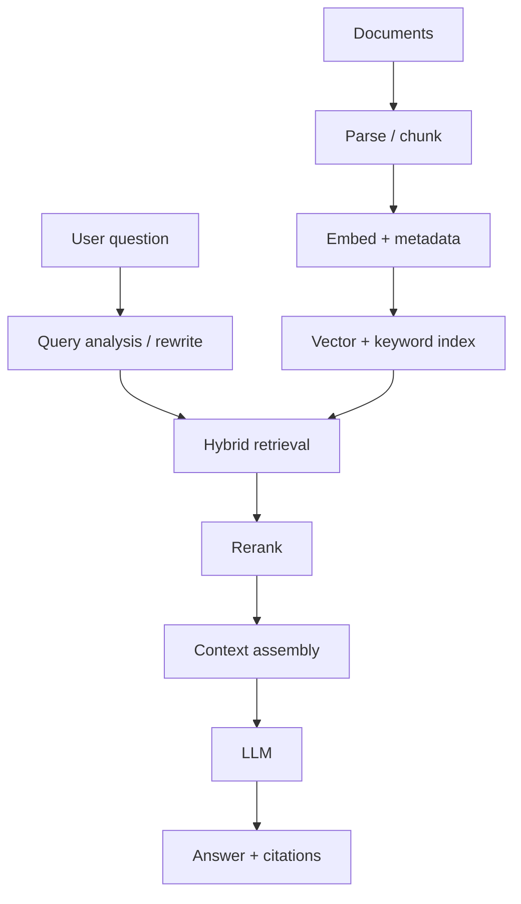
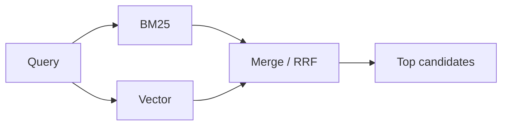

- **Retrieval-Augmented Generation** — answer with an LLM using external knowledge retrieved at query time
- Separates **knowledge acquisition** from **language generation** — LLM ≠ database
- Quality ≈ **retrieval quality × generation quality** — if retrieval is ~0, a great LLM still fails
- Prefer RAG when knowledge is private, dynamic, large, or document-based; prefer tools/SQL when the answer is deterministic
- When answers are wrong: **inspect retrieval before blaming the model**

## Mental model



| Worker | Job | Failure if weak |
| ------ | --- | --------------- |
| **Librarian (retrieval)** | Find the right evidence | Confident wrong answer |
| **Analyst (LLM)** | Reason over evidence | Hallucination / bad synthesis |

```text title='two phases'
Offline:  Documents → Parse → Chunk → Embed → Store
Online:   Question → Analyze → Retrieve → Rank → Context → LLM → Answer
```

```text title='working memory analogy'
Model parameters (long-term, frozen) + retrieved context (temporary working memory)
  = effective knowledge available now
```

- **Compiler analogy** — Documents → parse → chunks + metadata (IR) → index → retrieval → LLM execution; bad representation in → bad answers out

## Core terminology

| Term | Mental model | Example |
| ---- | ------------ | ------- |
| **Chunk** | Retrievable unit of knowledge | Leave-policy section |
| **Embedding** | Text → vector geometry | 1536-d dense vector |
| **Semantic search** | Meaning proximity | “connection dying” → timeout docs |
| **Keyword / BM25** | Exact term match | `ERR_CONNECTION_RESET` |
| **Hybrid search** | Semantic + lexical | Vector ∪ BM25 → merge |
| **Top-k** | Candidate count from a stage | Retrieve 50, keep 5 |
| **Reranking** | Expensive precision pass | Cross-encoder on top 50 |
| **Grounding** | Answer constrained by evidence | “Only use supplied context” |
| **Recall@k** | Fraction of relevant evidence found | 8/10 → 0.8 |
| **Precision@k** | Fraction of retrieved that is relevant | 3/5 → 0.6 |
| **Faithfulness** | Answer supported by context | No invented carry-over days |
| **ANN** | Approximate nearest neighbor | HNSW / IVFFlat |
| **Query rewriting** | Turn vague question into search-friendly query | “that cancel thing” → `customer cancellation policy` |
| **Metadata** | Structured facts on each chunk | `country`, `version`, `accessLevel` |
| **Citation** | Pointer from claim to source chunk | Handbook §3.2 |

## Stage objectives

| Stage | Optimize for |
| ----- | ------------ |
| **Chunking** | Good retrieval units |
| **Embedding** | Semantic representation |
| **Retrieval** | High recall, fast |
| **Reranking** | High precision |
| **Generation** | Correct, grounded answer |
| **Evaluation** | Measure each layer independently |

## Chunking

Ask: **smallest unit of knowledge that stands alone** — not “what token size?”

| Method | Quality | Complexity | Best for | Production pick (example) |
| ------ | ------- | ---------- | -------- | ------------------------- |
| **Fixed tokens** | Medium | Low | Baseline | Eval baseline: 500 tokens / 50 overlap on chat logs |
| **Sentence / paragraph** | Medium+ | Low | Prose, articles | Blog posts, news, essays |
| **Sliding window** | Medium+ | Low | Ideas span boundaries | Meeting transcripts: sentences 1–5, 3–7, 5–9 |
| **Recursive** | High | Medium | General purpose | Mixed internal wiki: section → paragraph → sentence |
| **Structure-aware** | High | Medium | Docs / markdown / HTML | Dev docs: chunk per `## heading`, prefix `Auth > OAuth > Code Flow` |
| **Parent-child** | High | Medium | Precision retrieve + rich generate | Enterprise policy: match a 1-paragraph child, send the whole section |
| **Semantic** | High | High | Topic boundaries in complex prose | Long research reports with no headings |
| **Late chunking** | High | High | Chunk meaning needs wider context | Contracts where “the Party” is defined pages earlier |
| **Domain-specific** | Very high | High | Code, legal clauses, tables | Regulation PDF → section/clause-level; code → function/class; finance → keep table rows whole |

```text title='default by source type'
Markdown / HTML docs   → structure-aware (heading / DOM) + recursive fallback
Regulation / legal PDF → section or clause level (article → clause), keep clause IDs in metadata
Code repo              → function / class / module
Financial reports      → table-preserving (row + column headers together)
FAQ / support KB       → one Q+A pair per chunk
Unstructured prose     → recursive; try semantic if eval shows topic bleed
```

```text title='size trade-off'
small chunks → precision ↑, context ↓
large chunks → context ↑, precision ↓, noise ↑
overlap      → boundary context ↑, storage / dupes / cost ↑
```

```text title='parent-child pattern'
Child (small)  → used for retrieval precision
Parent (large) → returned to LLM for context
```

- Chunk by **information structure** (headings, functions, clauses, tables) — not only length
- Make chunks **self-describing** — prefix the heading: `Annual Leave — Employees receive 20 days…`
- Unit: **tokens** > words > characters (context windows and cost are token-based)

```json title='chunk with metadata'
{
  "text": "...",
  "documentId": "leave-policy",
  "section": "Annual Leave",
  "country": "Australia",
  "version": 3,
  "effectiveFrom": "2026-07-01",
  "isCurrent": true,
  "accessLevel": "employee",
  "tenantId": "acme"
}
```

## Embeddings

| Choice | Prefer when | Watch out | Production pick (example) |
| ------ | ----------- | --------- | ------------------------- |
| **Dense vectors** | Default semantic retrieval | Exact IDs / codes | Always pair with BM25 for error codes / SKUs |
| **Smaller model (~384–768d)** | Cost, latency, storage | May lose domain nuance | High-QPS support bot over 50M chunks |
| **Larger / newer model (1536–3072d)** | Better Recall@k on your set | Param count ≠ quality | Low-volume, high-stakes legal / compliance search |
| **Domain-specific** | Legal, medical, code, finance | Narrower coverage | Code search over a monorepo; clinical notes |
| **Multilingual** | Cross-language corpus | Need eval per language | Global HR KB: English query must hit Spanish policy |
| **Asymmetric (query vs doc)** | Retriever trained that way | Don’t use one embed API blindly | Use `embed_query` for questions, `embed_document` for chunks |

- **Default** — strong general-purpose model first; switch to domain/multilingual only when your eval set shows a gap

```text title='dimension trade-off'
dimension ↑ → capacity ↑, storage ↑, index RAM ↑, compute ↑
1M × 1536d ≈ 4× the vector storage of 1M × 384d
Benchmark Recall@k / NDCG / latency / cost on your queries — not “best model” blogs
```

| Similarity | Measures | Use when |
| ---------- | -------- | -------- |
| **Cosine** | Angle | Most text embedding models (default) |
| **Dot product** | Angle × magnitude | Model docs say so; ≈ cosine on normalized vectors |
| **Euclidean (L2)** | Straight-line distance | Model trained for L2 |

- Rule: use the metric the **model + index** expect — mismatch → “SQL works, answers feel wrong”

```text title='exact vs ANN'
Exact search → highest accuracy, scans every vector (fine < ~100k vectors or as eval ground truth)
ANN (HNSW)   → fast, slightly less exact — production default at 1M+ vectors
```

## Retrieval



| Method | Strength | Weakness | Production pick (example) |
| ------ | -------- | -------- | ------------------------- |
| **BM25** | Exact terms, IDs, rare strings | Weak on paraphrase | Log / error-code search: `E1029`, `ERR_CONNECTION_RESET` |
| **Dense vector** | Semantic paraphrase | Weak on arbitrary codes | “Why does my connection keep dying?” → timeout docs |
| **Hybrid** | Broad coverage | More moving parts | **Default** for enterprise KB / dev docs |
| **Metadata filter** | Deterministic constraints | Needs good metadata | `country = 'AU' AND isCurrent` for HR policies |
| **Query rewriting** | Fixes vague / conversational Qs | Extra LLM call | Chat follow-ups: “what about the UK?” → `UK parental leave policy` |
| **Multi-query / expansion** | Recall on ambiguous Qs | Cost, latency, noise | “How does auth work?” → login flow, sessions, OAuth, middleware |
| **HyDE** | Bridges Q↔doc linguistic gap | Extra LLM call; hallucinated hypo-doc | User questions phrased very differently from formal docs |

- **Default** — hybrid (BM25 + vector) + metadata pre-filter; add rewriting for chat, multi-query/HyDE only when Recall@k is low

```text title='RRF idea'
RRF(d) ≈ Σ 1 / (k + rank(d))
— merge heterogeneous rank lists without calibrating raw scores
```

| Filter timing | Pattern | Prefer when | Production pick (example) |
| ------------- | ------- | ----------- | ------------------------- |
| **Pre-filter** | Metadata → then search | AuthZ / hard constraints | `tenantId`, ACL, `isCurrent` — always pre-filter |
| **Post-filter** | Search → then metadata | Soft filters; watch recall drop | “Prefer 2026 docs” — over-fetch (k=100) then filter |

```text title='top-k trade-off'
k ↑ → recall ↑, noise ↑, tokens ↑, latency ↑, cost ↑
Retrieve many → rerank → pass few to the LLM
Typical: retrieve 50–100 → rerank to 10 → send 5 to the LLM
```

## Reranking

```text title='two-stage search'
Huge corpus → fast retriever (recall) → top 50–200
            → expensive reranker (precision) → top 5–20 → LLM
```

| Method | Quality | Cost / latency | Notes | Production pick (example) |
| ------ | ------- | -------------- | ----- | ------------------------- |
| **Bi-encoder** | Medium | Very low | Candidate generation | Stage 1 over millions of chunks |
| **Cross-encoder** | High | Medium | Strong default reranker | **Default**: rerank top 50 → 10 for a support bot |
| **Pointwise** | High | Medium–high | Score each `query+doc` | Parallel scoring at scale (cross-encoder is pointwise) |
| **Pairwise** | High | High | Relative compare; O(N²) | Offline ranking-model training / small candidate sets |
| **Listwise** | Very high | Very high | Global order; context-limited | Final top-20 for legal research assistant |
| **LLM rerank** | High | High | Output consistency issues | Low-QPS, high-value: due diligence, medical lit review |
| **RRF** | Medium–high | Very low | Fuse multi-retriever ranks | Merge BM25 + vector lists before cross-encoder |

### Single-source vs multi-source

- **Single-source** (one corpus, e.g. product docs) — retriever → cross-encoder → top-k; main concern is relevance

```text title='multi-source danger'
Never blindly merge raw scores across Wiki / GitHub / Jira / BM25 / cosine
— score distributions differ (BM25 is unbounded, cosine is 0–1)
```

| Strategy | How | Best for | Production pick (example) |
| -------- | --- | -------- | ------------------------- |
| **Per-source + RRF** | Rank lists → RRF | Strong baseline | Start here for Wiki + GitHub + Jira |
| **Score normalize** | Map scores to 0–1, weight | Fragile distributions | Only with stable, well-understood sources |
| **Global reranker** | Pool candidates → one rerank | Best precision if budget allows | 20 per source → 60 pooled → cross-encoder → 10 |
| **Multi-stage** | Per-source top 50 → RRF → top 50 → global rerank | Large systems | Engineering assistant over 5+ sources |
| **Source-aware score** | Relevance × authority × freshness | Policies vs wikis vs archives | Official policy outranks a wiki page; current docs outrank archived |

- **Default** — RRF across sources, then a global cross-encoder; add authority/freshness weights when sources conflict

## Generation & grounding

```text title='context window budget'
System + question + retrieved context + history  ≤  context window
Goal = maximum useful context — not maximum tokens
```

- **Grounding prompt**: answer from context; say “don’t know” if missing
- RAG **reduces** hallucinations; it does **not** make them zero
- Citations need **claim ↔ evidence** alignment — a handbook title alone is not enough

```text title='trust levels'
System instructions  → trusted
User input           → partially trusted
Retrieved documents  → UNTRUSTED DATA (evidence, never commands)
```

- **Indirect prompt injection** — a retrieved doc says “Ignore previous instructions…”; instruct the model to treat context as evidence only

| Generation fix | Use when (example) |
| -------------- | ------------------ |
| **Stronger instructions** | Model adds facts not in context |
| **Citations per claim** | Compliance / legal answers must be auditable |
| **Structured output** | Downstream code parses the answer (JSON) |
| **Lower temperature** | Factual Q&A — “refund period = 30 days” must not become 60 |
| **Post-generation validation** | Check each claim against context before returning |
| **Model selection** | Multi-doc comparison needs stronger reasoning |

| Pattern | Idea | Production pick (example) |
| ------- | ---- | ------------------------- |
| **Context compression** | Shrink verbose hits — tokens ↓, loss risk ↑ | Long support threads → extract relevant facts first |
| **Lost in the middle** | Position critical evidence where the model uses it | Put top-reranked chunks first/last, not buried |
| **Hierarchical** | Doc → section → chunk | Large manuals: pick the manual, then the section |
| **Parent-child** | Retrieve small, generate with parent | Policy Q&A needing full-section context |
| **Agentic RAG** | Retrieve → reason → retrieve again | “Compare AU vs UK leave” — retrieve each, then definitions |
| **Graph RAG** | Relationship traversal | “Policies for engineers in AU under enterprise contract” — only when relationships matter |

## Evaluation

Evaluate **retrieval** and **generation** separately.

| Metric | Asks | Use when (example) |
| ------ | ---- | ------------------ |
| **Precision@k** | Of retrieved, how much is relevant? | Results shown to users / token budget tight |
| **Recall@k** | Of all relevant evidence, how much did we find? | **Primary** for stage-1 retrieval |
| **HitRate@k** | ≥1 relevant in top-k? | Single-answer FAQ bots |
| **MRR** | How early is first relevant? | One best doc matters (search box, “I’m feeling lucky”) |
| **NDCG** | How well ordered (graded relevance)? | **Primary** for rerankers |
| **Correctness** | Matches expected answer? | Any labeled Q&A set |
| **Faithfulness** | Supported by context? | **Primary** generation metric — all RAG |
| **Context relevance** | Retrieved stuff actually about the Q? | Separate retrieval vs generation bugs |
| **Context sufficiency** | Enough evidence to answer? | Multi-part / comparison questions (relevant ≠ sufficient) |
| **Answer relevance** | Addresses the user’s question? | Catch “passwords are important…” non-answers |
| **Completeness** | All required parts present? | “List the 3 deploy requirements” |
| **Citation precision / completeness** | Sources support claims; claims covered? | Legal, medical, compliance, research |

```text title='worked examples'
Precision@5: D1✓ D2✓ D3✗ D4✗ D5✓            → 3/5 = 60%
Recall@5:    4 relevant exist, 3 in top 5     → 3/4 = 75%
MRR:         first hit at ranks 1, 2, 5       → (1 + 0.5 + 0.2)/3 = 0.567
```

| Evaluator | Pros | Cons | Production pick |
| --------- | ---- | ---- | --------------- |
| **LLM-as-judge** | Scalable, handles nuance | Biased, uncalibrated, can hallucinate | Nightly regression over 1k questions |
| **Human labels** | Gold standard | Expensive, slow | Small benchmark (100–300 Qs) for high-value systems; calibrate the judge |

```json title='eval dataset row'
{
  "question": "How many annual leave days?",
  "expectedSources": ["employee-handbook/leave-policy"],
  "expectedAnswer": "20 days"
}
```

- Turns “RAG seems good” into “Recall@5 went from 72% → 89%”

```text title='diagnose with metrics'
Low Recall + high Faithfulness  → fix chunking / embed / retrieval
High Recall + low Faithfulness  → fix prompt / context / model / grounding
High both + low Correctness     → stale / conflicting / insufficient evidence or reasoning gap
```

```text title='starter dashboard'
Retrieval: Recall@5, Recall@10, NDCG@10
Generation: correctness, faithfulness, answer relevance
System: latency, cost, token usage, freshness
```

## Failure taxonomy

```text title='debug order'
1 ingested? → 2 chunked? → 3 metadata? → 4 retrieved?
→ 5 ranked high enough? → 6 in context? → 7 LLM used it?
```

| Symptom | Likely layer |
| ------- | ------------ |
| Document never found | Ingestion |
| Relevant section split badly | Chunking |
| Wrong tenant / country | Metadata / AuthZ |
| Exact error code missed | Lexical retrieval |
| Right doc ranked low | Ranking |
| Retrieved but omitted | Context selection |
| Right context, wrong answer | Generation |
| Right answer, wrong citation | Citation layer |
| Old policy returned | Freshness / versioning |

- **Ingestion** — PDF table `Plan A | $100 | 10 users` flattened into separate lines → row relationships lost; embedding and LLM are fine, the representation is broken
- **Retrieval** — bad embeddings, poor chunking, wrong metadata/filters, low recall, exact IDs missed, duplicate or outdated docs
- **Generation** — right context (“refund = 30 days”) but answer says 60 days

## Comparisons

| Approach | Changes | Prefer when | Production pick (example) |
| -------- | ------- | ----------- | ------------------------- |
| **RAG** | What the model knows at runtime | Private / changing / large docs | “What’s our 2026 pricing?” |
| **Fine-tune** | How the model behaves | Style, format, specialized patterns | Support ticket → strict JSON classification |
| **Both** | Behavior + current knowledge | Specialized + fresh corpus | Fine-tuned triage model + RAG over current runbooks |
| **Traditional search** | User reads hits | Browse / explore | Docs site search box |
| **Text-to-SQL** | Structured aggregates | Counts, sums, trends | “How many customers signed up last month?” |
| **APIs / tools** | Live state | Real-time values | “Current account balance?” → `getAccountBalance()` |

```text title='agent toolbox'
User → Agent → RAG | SQL/API | Tools → LLM
RAG is one tool — not the whole system
```

## Production

| Decision | Guidance |
| -------- | -------- |
| **Default stack** | Structure-aware / recursive chunks → hybrid BM25+vector → cross-encoder → citations |
| **Metadata** | Prefer filters for country/tenant/version/ACL over “smarter embeddings” |
| **AuthZ** | Enforce at retrieval (pre-filter); never trust the LLM to hide secrets |
| **Multi-tenant** | `tenantId` is a security boundary, not an optimization |
| **Freshness** | Incremental re-chunk / re-embed / upsert on change; version current docs |
| **Versioning** | Keep `version` / `isCurrent` / `effectiveFrom`; filter or boost current |
| **Latency** | LLM often dominates; still budget embed + search + rerank |
| **Cost** | LLM input tokens usually dominate variable cost — retrieval is cost control |
| **Cache** | Embeddings / retrieval / answers — key by version, tenant, permissions |
| **Maturity ladder** | Vector→LLM → +metadata/chunking → hybrid+rerank → rewrite/parent-child/cites → eval/freshness/AuthZ → agentic/graph |
| **Optimize order** | Ingestion → chunking → embeddings → recall → rerank → context → generation → latency/cost |

```text title='incremental indexing'
Document changed → detect change → delete old chunks → re-chunk → re-embed → upsert
```

```text title='latency budget (illustrative)'
query embedding     20ms
vector search       30ms
keyword search      20ms
reranking          100ms
prompt build         5ms
LLM generation     800ms
──────────────────────────
                    ~1s   ← LLM dominates
```

| Cache layer | Key on | Risk if keyed wrong |
| ----------- | ------ | ------------------- |
| **Query embedding** | Query text + model | Low |
| **Retrieval results** | Query + corpus version + tenant + ACL | Stale or unauthorized hits |
| **LLM answer** | Query + context hash + user scope | Leaking another user’s answer |

## System design checklist

```text title='clarify first'
1 What data? (structured vs unstructured)   5 Latency target?
2 How often does it change?                 6 Accuracy required?
3 Who can access what?                      7 Citations needed?
4 What query types? (IDs, paraphrase, multi-hop)
```

```text title='then design'
Ingest → parse → chunk → metadata → embed → hybrid index
→ retrieve → rerank → context → LLM → citations
Then discuss: security, freshness, evaluation, cost, latency, failure modes
```

- Weak answer: “embeddings into a vector DB and call GPT”

## Three trade-offs to retain

```text title='core trade-offs'
1 Recall ↔ Precision ↔ Cost
2 Context ↔ Noise ↔ Tokens
3 Quality ↔ Latency ↔ Complexity
```

```text title='four design questions'
1 How do I represent knowledge?
2 How do I find the right knowledge?
3 How do I fit it into context?
4 How do I make the model use it reliably?
```
