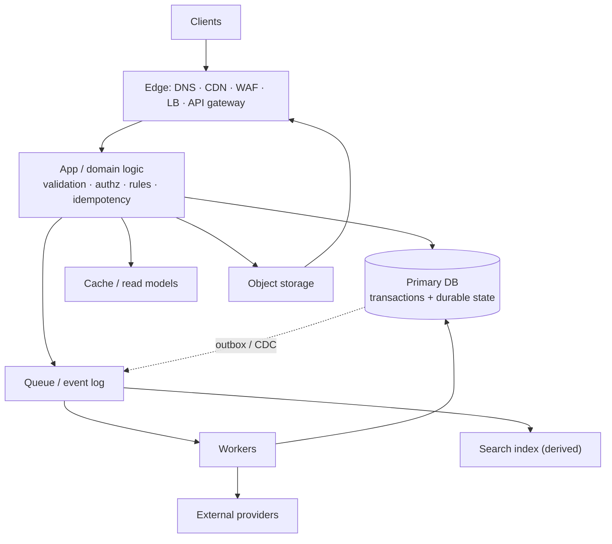
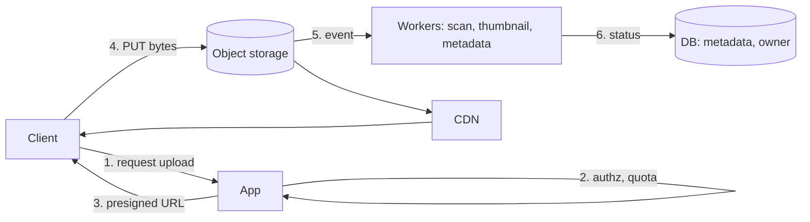
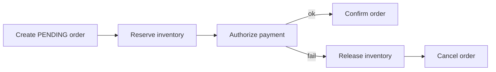
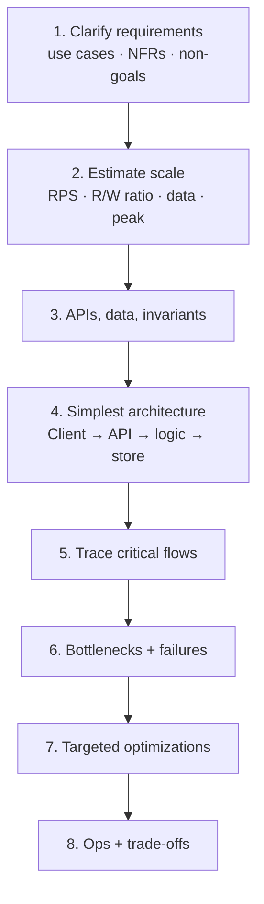

- **System design** — turn a product requirement into a system that stays **correct, fast, available, secure, and affordable** as it grows
  1. **Components** — which boxes exist and what each owns (e.g. order service owns orders)
  2. **Communication** — how they talk (e.g. HTTP for checkout, queue for emails)
  3. **Data ownership** — where state lives (e.g. Postgres = source of truth, Redis = copy)
  4. **Behavior under stress** — load, partial failure, change (e.g. payment provider times out)
- You never get every property at once — the skill is **choosing the right compromises**
- **Design from requirements → components**, never components → requirements ("Design Uber" ≠ draw Kafka + Redis)
- **The problem determines the architecture** — same framework, different dominant constraint
- For every component you add: **which requirement, which bottleneck/failure, what new complexity, what happens when it fails**

## Mental model

| # | Model | Example |
| - | ----- | ------- |
| 1 | **Bottleneck determines capacity** | 10 app servers can't fix a DB capped at 500 writes/s |
| 2 | **Networks create uncertainty** | Timeout ≠ failure — remote op may have completed |
| 3 | **Every optimization moves cost elsewhere** | Cache → invalidation; replicas → lag; microservices → network ops |
| 4 | **State is expensive; stateless compute is replaceable** | Cart in shared store, not one server's memory |
| 5 | **Design for feedback and recovery** | Detect, contain, auto-recover, keep evidence |



```text title='who protects what'
Database       → business invariants (source of truth)
Cache          → speed, within an accepted freshness model
Queue          → decouples work in time, absorbs bursts
Load balancer  → distributes work; cannot remove downstream bottlenecks
Replication    → copies for availability / read capacity (not consistency, not backups)
Partitioning   → distributes data; makes cross-partition queries/txns harder
Reliability    → contains failures instead of assuming none
Observability  → makes behavior measurable
Security / ops → decides whether it can be run safely in production
```

## Core terminology

| Term | Mental model | Example |
| ---- | ------------ | ------- |
| **Functional req.** | What the system does | Create order, search products |
| **Non-functional req.** | How well it must do it | p95 < 200 ms, 99.95% available |
| **Latency** | Time for one operation | 40 ms per request |
| **Throughput** | Ops per unit time | 2,000 req/s |
| **Tail latency** | Slow percentiles (p95/p99) | p50 40 ms but p99 900 ms |
| **Invariant** | Must never become false | Stock never negative |
| **Idempotent** | Repeat = same effect as once | `PUT /users/123`, `DELETE` |
| **Durability** | Confirmed data survives failure | Committed row survives node crash |
| **Availability** | Fraction of time usable | 99.9% ≈ 43 min down / month |
| **Replication** | More copies of same data | Primary + 2 read replicas |
| **Partitioning / sharding** | Split data into subsets | Hash by `user_id` |
| **Eventual consistency** | Replicas converge if writes stop | View count lags a few seconds |
| **Saga** | Multi-step workflow + compensations | Release stock if payment fails |
| **Outbox** | DB write + event in one txn | `orders` + `outbox` row, relay publishes |
| **Backpressure** | Slow/reject producers when consumers lag | `429` / bounded queue |
| **RPO / RTO** | Max data loss / max recovery time | 5 min / 30 min |
| **SLI / SLO** | Measured indicator / target for it | 99% of requests < 300 ms |

## Requirements

| Functional | Non-functional |
| ---------- | -------------- |
| Create an order | 99.95% availability |
| Search products | p95 search < 200 ms |
| Upload documents | 10k concurrent uploads |
| Process payments | No duplicate charges |
| View reports | Data fresh within 5 s |

- **Quality attributes** — latency, throughput, availability, durability, consistency, scalability, security, cost
- **Out of scope** — state non-goals explicitly ("email only, no SMS this iteration")
- Ask only questions that **materially change the architecture**
- **Define latency with percentiles**, not averages — tail comes from queueing, GC, cache misses, lock contention, slow deps

```text title="Little's Law (concurrency)"
L = λ × W
L = requests in flight, λ = throughput (req/s), W = time in system (s)

200 req/s × 0.25 s ≈ 50 in flight  → size connection pools, spot runaway concurrency
```

## Capacity estimation

Goal: numbers good enough to **rule out unsuitable designs**, then find the dominant resource.

```text title='back-of-envelope'
10M DAU × 20 req/day        = 200M req/day
200M / 86,400               ≈ 2,315 req/s average
× 5 peak factor             ≈ 11,575 req/s peak
200M × 2 KB                 ≈ 400 GB/day payload (excl. responses, indexes, replicas, backups)

Shortcut: 1M/day ≈ 12/s  ·  10M/day ≈ 116/s  ·  100M/day ≈ 1,157/s
```

- **Split reads vs writes next** — read-heavy → cache + replicas; write-heavy → batching, partitioning, different storage
- Estimate: avg + peak RPS, read/write ratio, data/day × retention, concurrency, growth

## Architectural styles

| Style | Pros | Cons | Best for |
| ----- | ---- | ---- | -------- |
| **Monolith** | Simple deploy, easy debugging, local txns | Shared release; coupling; can't scale modules separately | Early products, small teams |
| **Modular monolith** | Local calls + clear ownership | Shared runtime/cadence; needs discipline | Most growing products |
| **Microservices** | Team autonomy, independent deploy/scale, isolation | Network failures, distributed txns, versioning, debugging | Many teams + real independent scaling + ops maturity |
| **Event-driven** | Temporal decoupling, buffering, many consumers | Eventual consistency, dupes, tracing, ordering, schema evolution | Notifications, analytics, workflows |

- **Sync vs async** is a communication style, not an architecture — sync: `GET /products/123`; async: enqueue report job
- **Rule** — start simplest; add a boundary only when you can name the problem it solves

## API design

| Technique | Strengths | Weaknesses | Good fit |
| --------- | --------- | ---------- | -------- |
| **REST + JSON** | Simple, ubiquitous, cacheable | Payload overhead, schema drift | Public APIs, CRUD, web/mobile |
| **GraphQL** | Client picks fields | Authz, query-cost control, caching | Diverse clients |
| **gRPC + Protobuf** | Compact, typed, generated clients | Browser support, proxies | Internal service-to-service |
| **WebSockets** | Bidirectional, persistent | Connection mgmt, horizontal scale | Chat, collaboration |
| **SSE** | Simple server → client stream | One-way; reconnect handling | Progress, notifications |
| **Webhooks** | Event push, no polling | Delivery failure, signatures, dupes | Third-party integrations |

```text title='HTTP method semantics'
GET     read, no business side effects
POST    create / execute — NOT inherently idempotent → needs idempotency key
PUT     replace — conventionally idempotent
PATCH   partial modify
DELETE  remove — designed to be idempotent
```

| Pagination | Pros | Cons |
| ---------- | ---- | ---- |
| **Offset** `LIMIT 20 OFFSET 1000` | Simple, jump to page | Slow at large offsets; skips/dupes on change |
| **Cursor / keyset** `WHERE id > :last` | Fast with index; stable | Deterministic order needed; no page jumps |
| **Snapshot** | Consistent across pages | Version management cost |

- Prefer **keyset** for large, changing datasets
- **API rules** — stable IDs · validate at boundary · authn + authz separately · consistent errors · version breaking changes · rate + size limits · idempotency keys for harmful retries
- An API is a **behavioral contract** — errors, retries, concurrency, security, compatibility — not just URL + JSON

## Load balancing

| Algorithm | Pros | Cons |
| --------- | ---- | ---- |
| **Round robin** | Simple | Ignores capacity/load |
| **Weighted RR** | Heterogeneous nodes | Static weights |
| **Least connections** | Uneven request durations | Connections ≠ load |
| **Least response time** | Adapts to performance | Noisy feedback loops |
| **Consistent hashing** | Affinity, cache locality | Hot keys overload one node |
| **Power of two choices** | Good spread, low coordination | Needs a load signal |

- **L4** — routes by IP/port; fast, protocol-agnostic · **L7** — routes by path/host/header/cookie; flexible
- **Health checks** — **liveness** (restart?), **readiness** (send traffic?), **dependency** (downstream OK?)
- Don't restart every instance because one dependency is down — **amplifies outages**
- **Connection draining** — let in-flight requests finish before removing an instance
- A load balancer **does not create capacity** — it spreads work and removes unhealthy nodes

## Compute scaling

| Technique | Advantage | Disadvantage |
| --------- | --------- | ------------ |
| **Vertical** | No code/coordination changes | Hardware ceiling, big failure unit |
| **Horizontal** | More capacity + failure domains | Needs stateless app / shared state |
| **Autoscaling** | Capacity tracks demand | Lag, oscillation, cost spikes |
| **Scheduled** | Ready before known peaks | Misses surprises |
| **Queue-based workers** | Scale on backlog | Delay grows if producers outpace |

- **Stateless servers** — any instance serves any request → easy replace, deploy, scale out
- Horizontal scaling helps only if **downstream deps** (DB, locks) can absorb it

## Choosing a database

Start from **access patterns + correctness**, not popularity.

| Type | Examples | Pros | Cons | Best for |
| ---- | -------- | ---- | ---- | -------- |
| **Relational** | PostgreSQL, MySQL | Joins, constraints, transactions | Write scale-out is hard | Orders, payments, users, inventory |
| **Document** | MongoDB | Flexible schema, aggregates | Duplication, cross-doc relations | Document-shaped aggregates |
| **Key-value** | Redis, DynamoDB | Fast lookups, high throughput | Limited ad hoc queries, hot keys | Sessions, cache, counters |
| **Wide-column** | Cassandra | Distributed read/write scale | Model follows queries | Huge write volume, known queries |
| **Graph** | Neo4j | Multi-hop traversal | Specialized skills | Fraud rings, dependencies |
| **Time-series** | InfluxDB, TimescaleDB | Time-range queries, downsampling, retention | Cardinality, niche queries | Metrics, telemetry, sensors |

- **Default: relational** — add specialized stores only for a demonstrated need
- 5 databases = 5× backups, access control, monitoring, failure modes, expertise

## Data modeling

Model around **business invariants**, not syntax.

```sql title='e-commerce schema with invariants'
CREATE TABLE orders (
  id          BIGINT GENERATED ALWAYS AS IDENTITY PRIMARY KEY,
  customer_id BIGINT NOT NULL REFERENCES customers(id),  -- every order has a customer
  status      TEXT NOT NULL,
  created_at  TIMESTAMPTZ NOT NULL DEFAULT now()
);

CREATE TABLE order_items (
  order_id   BIGINT NOT NULL REFERENCES orders(id),
  product_id BIGINT NOT NULL,
  quantity   INTEGER NOT NULL CHECK (quantity > 0),
  unit_price NUMERIC(12, 2) NOT NULL CHECK (unit_price >= 0),  -- historical price, not live catalog
  PRIMARY KEY (order_id, product_id)
);
```

| Approach | Pros | Cons |
| -------- | ---- | ---- |
| **Normalized** | Integrity, simple updates | Joins on read |
| **Denormalized** | Fast reads, fewer joins | Duplicated state to keep in sync |
| **Materialized views** | Precomputed results | Refresh cost / staleness |
| **CQRS read models** | Read shape optimized separately | More infra, eventual consistency |

- **Normalize to protect correctness; denormalize to optimize a measured workload**

## Indexes

```sql title='composite index matches filter + sort'
SELECT id, status, created_at FROM orders
WHERE customer_id = 42 ORDER BY created_at DESC LIMIT 20;

CREATE INDEX idx_orders_customer_created ON orders (customer_id, created_at DESC);
```

| Index | Useful for | Trade-off |
| ----- | ---------- | --------- |
| **B-tree** | Equality, ranges, sort | Write + storage overhead |
| **Hash** | Equality only | No ranges/order |
| **Composite** | Multi-column filter + sort | Column order matters |
| **Partial** | Selective predicate (`WHERE status='open'`) | Covers subset only |
| **Covering** | Answer from index alone | Bigger index, more write work |
| **Full-text** | Token search | Relevance tuning |
| **Spatial** | Geo queries | Specialized operators |

- **Leftmost prefix** — `(customer_id, status, created_at)` helps `customer_id` filters, not `status`-only
- Indexes cost writes, memory, maintenance; low selectivity = useless
- **Use query plans + real workload** — not "column is in WHERE, so index it"

## Transactions and concurrency

- **ACID** — **A**tomic (all-or-nothing) · **C**onsistent (invariants hold) · **I**solated (per chosen level) · **D**urable (survives crash)

| Isolation | Benefit | Limitation |
| --------- | ------- | ---------- |
| **Read uncommitted** | Least coordination | Dirty reads (Postgres treats as read committed) |
| **Read committed** | Common default | Non-repeatable reads, write anomalies |
| **Repeatable read / snapshot** | Stable snapshot | Write skew possible |
| **Serializable** | Strongest | More aborts + retries |

| Technique | How | Pros | Cons |
| --------- | --- | ---- | ---- |
| **Pessimistic lock** | `SELECT … FOR UPDATE` then write | Easy to reason | Contention, deadlocks |
| **Optimistic (version)** | `UPDATE … WHERE version = :v` | Great at low contention | Retries on conflict |
| **Atomic conditional update** | Invariant inside the `WHERE` | No read-check-write race | Check affected rows |

```sql title='atomic conditional update (prevents overselling)'
UPDATE inventory
SET available_quantity = available_quantity - $1
WHERE product_id = $2
  AND available_quantity >= $1;
-- 0 rows affected → reservation failed
```

```text title='race: read-check-write'
A reads stock = 1      B reads stock = 1
A writes stock = 0     B writes stock = 0   → both "bought" the last item
```

```text title='4 concurrency questions'
1. What invariant must never be violated?
2. Which concurrent operations can conflict?
3. What enforces it: constraint, atomic update, lock, or transaction?
4. What happens on conflict or failure?
```

## Replication

- **Primary-replica** — writes → primary; replicas stream changes and may serve reads
- **Pros** — read throughput, recovery options, isolate analytics
- **Cons** — **replication lag → stale reads**, failover complexity, cost; **replicas ≠ backups**

| Mode | Advantage | Disadvantage |
| ---- | --------- | ------------ |
| **Synchronous** | Ack waits for replica → stronger durability | Higher latency; blocks if replica down |
| **Asynchronous** | Low write latency | Primary crash can lose acked writes |

- **Read-after-write fixes** — read from primary briefly after a write · track replication position / session consistency · wait for replica to catch up · stronger consistency setting

## Partitioning and sharding

- **Replication = copies; partitioning = splits** — sharding is horizontal partitioning across nodes

| Strategy | Pros | Cons |
| -------- | ---- | ---- |
| **Range** (date, ID) | Range scans, easy retention, pruning | Hot newest partition, skew |
| **Hash** | Even spread | Range queries awkward; resharding moves data |
| **Consistent hashing** (+ vnodes) | Minimal remap on node change | Doesn't fix hot keys |
| **Directory** | Flexible placement/migration | Directory is a dependency |

- **Good shard key** — high cardinality, even distribution, matches common queries, low hotspot risk
- Bad: timestamp (all writes hit newest) · still-risky: tenant ID with one giant tenant
- **Costs** — fan-out queries, global sort/pagination, cross-shard uniqueness, cross-shard txns, resharding
- **Order of escalation** — vertical scale → query optimization → replicas → table partitioning → sharding

## CAP and consistency

- **CAP** — during a **network partition**, you can't guarantee both linearizable **C** and full **A**; it's not "pick 2 always"

| Model | Users observe | Cost |
| ----- | ------------- | ---- |
| **Strong / linearizable** | Single global order, real-time | Coordination, latency, less availability |
| **Eventual** | Converges once updates stop | Stale reads, conflict resolution |
| **Causal** | Cause before effect preserved | Metadata, complexity |
| **Session** (read-your-writes) | Client sees its own writes | Routing / tracking |

| Favor strong | Eventual is fine |
| ------------ | ---------------- |
| Account balances | View counts |
| Inventory allocation | Search indexes |
| Payment state | Recommendation feeds |
| Unique ownership | Dashboards, derived read models |

- Decide by **business semantics**, not technology label; eventual ≠ no consistency

## Object storage and CDN

| Storage | Best for | Trade-off |
| ------- | -------- | --------- |
| **Block** | DB volumes, VM disks | Volume management |
| **File** | Shared directory trees | Metadata / shared-access limits |
| **Object** | Images, video, docs, backups | Not POSIX, not transactional |



- App never proxies bytes · multipart = resilient but needs cleanup · versioning = recovery but cost · CDN needs versioned URLs or invalidation
- **DB = authoritative record; object store = blobs; workers = processing; CDN = delivery**

## Caching

| Placement | Pros | Cons |
| --------- | ---- | ---- |
| **Browser / client** | Zero network | Invalidation, privacy |
| **CDN** | Geo latency, origin offload | Cache keys, invalidation |
| **Reverse proxy** | Central HTTP cache | Poor for personalized |
| **App-local** | Fastest | Per-instance copies |
| **Distributed** (Redis) | Shared | Network hop, memory, eviction |
| **DB buffer** | Automatic | Not a query-tuning substitute |

| Strategy | How | Pros | Cons |
| -------- | --- | ---- | ---- |
| **Cache-aside** | App: miss → DB → fill | Simple, lazy | Cold misses, stale, racing fills |
| **Read-through** | Cache loads on miss | Simple callers | Cache owns more logic |
| **Write-through** | Write cache + DB together | Fresh after write | Write latency; not atomic |
| **Write-behind** | Write cache, persist later | Fast, coalesced writes | Data loss unless durable buffer |

```ts title='cache-aside with stampede protection'
async function getProduct(id) {
  const hit = await cache.get(`product:${id}`)
  if (hit) return hit

  return singleFlight(`product:${id}`, async () => {   // coalesce concurrent misses
    const row = await db.products.findById(id)
    await cache.set(`product:${id}`, row, { ttl: 300 + jitter(60) })
    return row
  })
}
```

- **Invalidation** — TTL · explicit delete (can race) · versioned keys (immutable assets) · event-driven · bounded staleness
- **Stampede** (hot key expires, everyone hits DB) — single-flight, TTL jitter, background refresh, stale-while-revalidate, per-key lock
- 90% hit rate ≈ 10% to DB — but bursts on the remaining 10% still matter
- Decide **how stale is OK** and **what happens when cache is empty/down** — a cache is not the source of truth

## Messaging

| Pattern | Core idea | Fit | Trade-off |
| ------- | --------- | --- | --------- |
| **Work queue** | One worker per job | Image processing, reports | Retries, poison msgs, backlog |
| **Pub/sub** | Every subscriber gets a copy | Notifications, fan-out | Per-subscription retry semantics |
| **Event log** | Ordered, partitioned, replayable | Streams, pipelines | Partition ordering, offsets, retention |

- **RabbitMQ** — routing + task distribution · **Kafka** — durable, replayable event streams

| Guarantee | Meaning | Implication |
| --------- | ------- | ----------- |
| **At-most-once** | May lose, never dupe | Fire-and-forget metrics |
| **At-least-once** | Retries until ack → dupes | **Consumers must be idempotent** |
| **Exactly-once** | Only inside a broker's txn boundary | External side effects still need idempotency |

- **Queue techniques** — retries w/ backoff + jitter · dead-letter queue · visibility timeout / lease · ack after processing · backpressure · consumer concurrency limits · partition for ordered parallelism · poison-message handling
- **Queueing theory** — need processing rate μ > arrival rate λ; wait time explodes near 100% utilization
- A queue turns an **immediate dependency into a delayed one** — absorbs bursts, can't fix under-capacity

## Search and derived data

```text title='derived index pipeline'
Primary DB → outbox / CDC → event pipeline → search index → search API
```

| Technique | Pros | Cons |
| --------- | ---- | ---- |
| **SQL full-text** | One less system | Limited relevance at scale |
| **Inverted index** | Fast term ranking | Refresh lag, ops |
| **Prefix / autocomplete** | Fast suggestions | Extra structures |
| **Vector** | Semantic similarity | Approximate recall, cost |
| **Hybrid** | Lexical + semantic | Score fusion complexity |

- Search index is **derived, not authoritative** — handle dupes, out-of-order, deletes, failed indexing, full reindex, backfill

## Failure handling

| Technique | What | Trade-off |
| --------- | ---- | --------- |
| **Timeouts / deadlines** | Bound resource hold time | Remote op may continue |
| **Retry + backoff + jitter** | Retry transient errors | More load, possible dupes |
| **Circuit breaker** | Stop calling a failing dep, probe later | Tuning; can delay recovery |
| **Bulkhead** | Separate pools per dep/workload | More limits to manage |
| **Rate limiting** | Cap per user/tenant/API | Reject/delay policy needed |
| **Graceful degradation** | Drop non-essentials | Incomplete UX (product page w/o recs) |

```text title='retry storm'
Dependency capacity: 1,000 req/s  · incoming: 1,000 req/s · starts failing
3 retries each → up to ~4,000 req/s attempted → cascading failure
Fix: bounded retries + backoff + jitter + concurrency limits + propagated deadlines
```

## Idempotency

Goal: repeated attempts **converge on one correct business outcome** (not "deliver once").

```sql title='idempotency record'
CREATE TABLE idempotency_records (
  idempotency_key TEXT PRIMARY KEY,
  status          TEXT NOT NULL,       -- in_progress | done | failed
  response        JSONB,
  created_at      TIMESTAMPTZ NOT NULL DEFAULT now()
);
```

```ts title='idempotent POST handler'
async function createPayment(req) {
  const key = req.headers['Idempotency-Key']
  const existing = await db.idempotency.find(key)
  if (existing?.status === 'done') return existing.response
  if (existing?.status === 'in_progress') return conflict(409)

  await db.tx(async (tx) => {
    await tx.idempotency.insert({ key, status: 'in_progress' })   // PK blocks concurrent dupes
    const result = await provider.charge(req.body, { idempotencyKey: key })
    await tx.idempotency.update(key, { status: 'done', response: result })
  })
}
```

- Define: concurrent duplicate behavior, in-progress handling, key expiry (≥ retry + reconciliation window)
- **External side effects** — use the provider's idempotency key; **treat timeouts as ambiguous** and reconcile

## Distributed transactions

| Approach | How | Pros | Cons |
| -------- | --- | ---- | ---- |
| **2PC** | Prepare → commit/abort | Atomic across participants | Blocking, coordinator failure, poor across services |
| **Saga** | Steps + compensations | Long-running, no global lock | Visible intermediate states; compensation ≠ perfect undo |
| **Orchestration** | Coordinator picks next step | Visible state, central recovery | Central component |
| **Choreography** | Services react to events | Loose coupling | Hard to trace end-to-end |



- **Transactional outbox** — solves "DB committed but event lost" and "event sent but DB rolled back"

```text title='outbox pattern'
BEGIN
  UPDATE orders ...
  INSERT INTO outbox (event_type, payload) ...
COMMIT
relay / CDC → publish committed outbox rows → broker
consumers process idempotently · mark published · clean up
```

## Coordination and consensus

| Concept | Meaning |
| ------- | ------- |
| **Leader election** | One node owns a responsibility |
| **Consensus** (Raft) | Agree on value/order under failures |
| **Quorum** | Required subset for a decision |
| **Lease** | Time-bounded authority (clock-sensitive) |
| **Fencing token** | Monotonic token; storage rejects stale leaders |

- **A lock isn't enough** — holder pauses (GC), lease expires, new owner acts, old one resumes and writes → fencing rejects it
- Use coordination only where a real invariant needs it — not on every operation

## Availability and disaster recovery

- **Availability** (usable?) ≠ **durability** (data survives?) ≠ **recoverability** (can we restore?)

| Technique | Benefit | Limitation |
| --------- | ------- | ---------- |
| **Multiple instances** | Survive instance loss | Shared deps still fail |
| **Multi-zone** | Survive zone loss | Cost; region can fail |
| **DB failover** | Recover from node loss | Promotion, data-loss window |
| **Backups** | Deletion, corruption | Restore time; can be compromised |
| **Cross-region replication** | Regional DR | Lag, split-brain, cost |
| **Immutable backups** | Ransomware / destructive ops | Access control, tested restores |

```text title='availability arithmetic'
99.9%  / 30 days ≈ 43.2 min downtime
99.99% / 30 days ≈ 4.32 min downtime
3 serial deps at 99.9% → 0.999³ ≈ 99.70%   (independent failures; correlated is worse)
```

- **RPO** — tolerable data loss (e.g. 5 min) · **RTO** — tolerable recovery time (e.g. 30 min) — **test them**
- Every added **synchronous** dependency lowers end-to-end availability

## Observability

| Signal | Tells you |
| ------ | --------- |
| **Metrics** | Something is wrong (rate, errors, latency p99, queue depth) |
| **Logs** | Detailed events (structured, with trace ID, no secrets) |
| **Traces** | Where time/failure happened across services + queues |

- **SLI** — measured behavior (share of requests < 300 ms) · **SLO** — target (99%) · **error budget** — allowed failure, gates release risk
- **Alert on user impact** — errors + latency + meaningful volume, not raw CPU
- **Queue age > queue depth** — says how long work has waited

## Security

- **Authentication** — who are you? · **Authorization** — what may you do? (logged in ≠ allowed to see another's invoice)

| Technique | Pros | Cons |
| --------- | ---- | ---- |
| **Server sessions** | Easy revocation | Session store availability |
| **JWT** | Stateless distributed auth | Hard revocation, stale claims |
| **OAuth 2.0 / OIDC** | Standard delegation + identity | Config complexity |
| **RBAC** | Roles → permissions | Role explosion |
| **ABAC** | Attribute/context policies | Complex evaluation |
| **Network segmentation** | Fewer paths | Not a substitute for authz |
| **Encryption at rest / in transit** | Data exposure protection | Key + cert lifecycle |

```text title='secure request path'
TLS + network controls → authn → authz (resource + op) → input validation + size limits
→ business invariants → scoped data access → audit log
```

- Plus: secret manager, least-privilege service identities, dependency scanning, patching, rate limits, injection protection
- **Every trust boundary needs an explicit decision** — private network ≠ authorized

## Deployment and cost

| Strategy | Pros | Cons |
| -------- | ---- | ---- |
| **Rolling** | Low overhead | Old + new coexist |
| **Blue-green** | Instant switch + rollback | 2× capacity, shared state must be compatible |
| **Canary** | Limited blast radius | Needs telemetry + traffic routing |
| **Feature flags** | Decouple release from deploy | Flag debt |
| **Shadow traffic** | Test on real requests | Extra load; suppress side effects |

```text title='expand → migrate → switch → contract'
1. Expand    add nullable column / compatible schema
2. Migrate   code handles old + new; backfill
3. Switch    reads + writes use new shape
4. Contract  drop old once no running version uses it
```

- **Config** (timeouts, flags, endpoints) ≠ **secrets** (keys, passwords) — secrets in a manager, rotated, never in images/logs/bundles
- **Cost drivers** — compute, DB storage/IOPS/replicas, cross-region transfer, cache memory, message retention, log/trace volume, backups, **on-call time**
- Optimize **total** cost incl. operational complexity — split services = independence + more failure modes; consolidate = fewer parts + less isolation

## Design workflow



- **Step 4** — add only when justified: cache (repeated reads) · queue (async/bursts) · LB (multiple instances) · replica (read capacity) · object store (files) · search index · new service (independent ownership/scale)
- **Step 5** — per flow: which components, what read/written, **where is success decided**, dep timeout?, caller retry?, concurrent modify?
- **Step 6** — traffic spike (what saturates first?) · dependency failure · concurrent ops · recovery without loss/dupes
- **Step 7** — per decision: why it fits, alternatives, cost, remaining limits, **what evidence would change it**
- Invariants often drive DB, transaction, and idempotency choices **more than raw traffic**

```text title='45-min interview timeline'
0–5    Requirements       use cases, constraints, scope
5–10   Capacity           traffic, storage, R/W ratio
10–15  API + data         interfaces, entities, invariants
15–25  High-level design  components + main flow
25–38  Deep dive          dominant bottleneck, consistency, concurrency, failures
38–45  Trade-offs + ops   alternatives, monitoring, recovery, security, scaling path
```

## Worked examples

| Dimension | URL shortener | E-commerce checkout | Notification service |
| --------- | ------------- | ------------------- | -------------------- |
| **Dominant challenge** | Fast reads | Correct business state | Reliable background delivery |
| **Consistency** | Unique mapping; link-change freshness | Strong invariants: stock, orders, payments | Durable job state + consent |
| **Key optimization** | Caching | Transactions + idempotency | Queues + worker pools |
| **Key failure** | Cache/DB down | Ambiguous payment outcome | Provider outage, backlog |
| **Scaling** | Cache → replicas → partition | By workload + service boundary | Consumers within provider limits |
| **Complexity** | Low | Moderate–high | Moderate |

### URL shortener

```text title='scale'
1M links/day      ≈ 12 writes/s
100M redirects/day ≈ 1,157 reads/s  (peak ×5 ≈ 5,787/s)
R/W ≈ 100:1 → read-heavy → cache
```

```text title='API + model'
POST /api/links {url}  → {code: "aB91xZ", shortUrl}
GET  /aB91xZ           → 302 redirect

Link: code (PK) · destination_url · created_at · expires_at?
Invariant: one code → one destination
```

```text title='architecture'
Client → LB → stateless URL API → cache → DB
                                └→ async analytics events (keep redirects fast)
```

- **Create** — validate URL → generate code → insert with unique constraint → on collision regenerate → return after commit
- **Redirect** — cache → miss → DB → check expiry → `302` (allows destination change)
- **Sequential base62** — compact, no collisions, but enumerable + needs coordinated allocation
- **Random codes** — hard to guess, but collisions (birthday paradox: P ≈ 1 − e^(−k(k−1)/2N)) → still need unique constraint
- Invalidate cache on delete/expiry · abuse/phishing checks + rate limits
- **Don't add yet** — microservices, Kafka, sharding

### E-commerce checkout

```text title='API'
POST /api/orders
Idempotency-Key: checkout-8f21
{items: [{productId: "P100", quantity: 2}]}
→ {orderId: "O123", status: "PENDING"}
```

```text title='architecture'
Checkout API → Order service + SQL (order + idempotency record + outbox, one txn)
  → durable broker → Inventory (reserve) · Payment (authorize)
  → workflow coordinator → confirm | compensate | reconcile
```

- **Overselling** — atomic conditional `UPDATE … WHERE available_quantity >= $1`; reserve multi-item orders together
- **Duplicate charge** — same provider idempotency key on retry · persist workflow state · **timeout = ambiguous → query provider before retrying**
- **Partial failure** — saga compensates (release stock, cancel); compensation itself can fail → retry/reconcile
- **Product decision** — respond on confirmed vs return `PENDING` (faster, isolated, but UI needs states + status updates)
- Small app: modular monolith + one DB transaction may be enough; broker only when async isolation matters
- Monitor queue age, payment failure rate, stuck orders, compensation failures

### Notification service

```text title='API + model'
POST /api/notifications
Idempotency-Key: invoice-reminder-123
{userId, channel: "email", templateId, data}  → 202 + notificationId

Notification: id · user_id · channel · template_id · status · attempt_count · next_attempt_at · delivered_at
(separate business notification from per-channel delivery attempts)
```

```text title='architecture'
Business services → Notification API → SQL + durable queue
  → Email workers · SMS workers · Push workers   (separate pools)
  → external providers → delivery status / webhooks
Preference store: consent, channels, templates, quiet hours
```

| Problem | Technique | Trade-off |
| ------- | --------- | --------- |
| Traffic spike | Durable queue | Longer waits |
| Provider outage | Backoff + jitter | Delivery delay |
| Provider rate limit | Per-provider concurrency/rate limits | Lower peak throughput |
| Invalid recipient | Permanent-failure classification + DLQ | Ops handling |
| Worker crash | Durable jobs, ack after processing | Duplicate attempts possible |
| Duplicate request | Idempotency key + dedupe store | Storage/retention |
| Slow SMS | Separate worker pool | More infra |
| Unsubscribe | **Recheck consent at send time**, not just enqueue | Extra lookup |

- Provider **accepted ≠ delivered** — track separately via receipts
- Provider timeout doesn't mean not sent — exactly-once external delivery needs provider cooperation
- Scale workers by **backlog + provider limits**, not just "add more"

## Decision matrix

| Problem | First techniques | Main trade-off |
| ------- | ---------------- | -------------- |
| Slow DB reads | Query plans, indexes, connection pooling | Write overhead |
| Repeated expensive reads | Cache-aside, materialized views | Staleness |
| Read-heavy | Read replicas, caching | Lag, routing |
| High write volume | Batching, partitioning | Latency, coordination |
| Bursty background work | Durable queue + workers | Delay, retries |
| Slow downstream | Deadlines, bulkheads, circuit breakers | Fail fast / degrade |
| Duplicate requests | Idempotency keys, unique constraints | Retention |
| Large files | Presigned uploads, CDN | Authz, lifecycle |
| Complex search | Dedicated search index | Eventual consistency, reindex |
| Multi-step workflow | Saga + durable state | Intermediate states |
| Instance failure | LB, health checks, redundancy | Extra capacity |
| Regional disaster | Tested backups, replication, failover | Cost, RPO window |
| Data > one node | Partitioning / sharding | Cross-partition queries |
| Too many sync deps | Async messaging, degradation | Delayed consistency |
| High infra cost | Consolidate, right-size, lifecycle | Less isolation |

## Review checklist

```text title='architecture review questions'
Requirements  core use cases + non-goals? latency/availability/durability/consistency targets? R/W ratio + peak?
Data          source of truth per entity? invariants under concurrency? which queries need indexes/txns/views?
Scale         current bottleneck? at 10× traffic? one hot tenant/key?
Reliability   dep times out AFTER completing? can retry duplicate effects? how are msgs/DB/external effects reconciled?
Operations    errors, latency, queue age, saturation monitored? rollback + safe schema change? RPO/RTO tested?
Trade-offs    simplest design that meets reqs? which complexity is justified by a measured constraint? new failure modes per component?
```

## Retain

| Decision | Guidance |
| -------- | -------- |
| Architecture style | Start monolith / modular monolith; split only for a named problem |
| Database | Relational by default; specialize for proven access patterns |
| Read scaling | Indexes → cache → replicas → partitioning |
| Write correctness | Constraints + atomic conditional updates, not read-check-write |
| Retries | Only with idempotency, backoff + jitter, bounded attempts |
| Caching | Define freshness + empty/down behavior before adding |
| Cross-service writes | Saga + outbox + idempotent consumers, not 2PC |
| Replicas | Not backups; plan for lag and read-after-write |
| Timeouts | Ambiguous outcome — reconcile, don't blindly repeat |
| Reliability targets | Percentile SLOs, tested RPO/RTO, alert on user impact |
| Interview mistakes | Premature microservices · cache w/o freshness · unsafe retries · replicas = durability · designing for imaginary scale |
| Strong answer | Say what you chose, what you rejected, and why |
